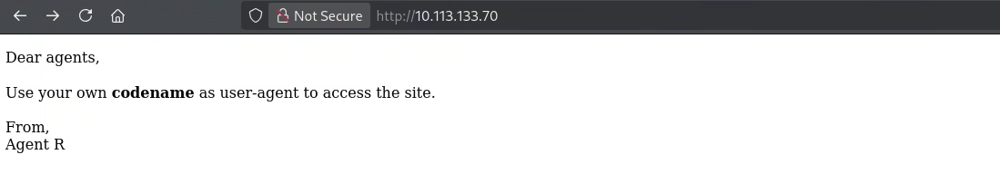
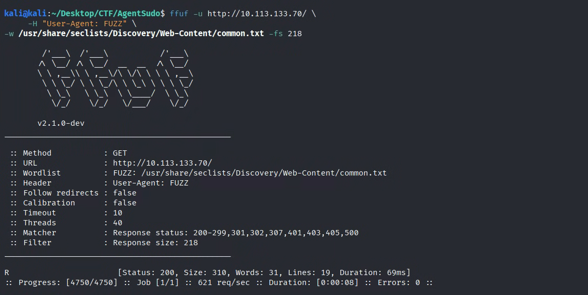

# Agent Sudo

**LINK:** [https://tryhackme.com/room/agentsudoctf](https://tryhackme.com/room/agentsudoctf)

**IP: 10.113.133.70**

Come primo step, ho proceduto come di consueto ad enumerare i servizi esposti

```bash
kali@kali:~/Desktop/CTF/AgentSudo$ sudo nmap -sS -sV -sC -p- 10.113.133.70 
[sudo] password for kali: 
Starting Nmap 7.99 ( https://nmap.org ) at 2026-09-07 15:46 -0400
Nmap scan report for 10.113.133.70
Host is up (0.065s latency).
Not shown: 65532 closed tcp ports (reset)
PORT   STATE SERVICE VERSION
21/tcp open  ftp     vsftpd 3.0.3
22/tcp open  ssh     OpenSSH 7.6p1 Ubuntu 4ubuntu0.3 (Ubuntu Linux; protocol 2.0)
| ssh-hostkey: 
|   2048 ef:1f:5d:04:d4:77:95:06:60:72:ec:f0:58:f2:cc:07 (RSA)
|   256 5e:02:d1:9a:c4:e7:43:06:62:c1:9e:25:84:8a:e7:ea (ECDSA)
|_  256 2d:00:5c:b9:fd:a8:c8:d8:80:e3:92:4f:8b:4f:18:e2 (ED25519)
80/tcp open  http    Apache httpd 2.4.29 ((Ubuntu))
|_http-title: Annoucement
|_http-server-header: Apache/2.4.29 (Ubuntu)
Service Info: OSs: Unix, Linux; CPE: cpe:/o:linux:linux_kernel

Service detection performed. Please report any incorrect results at https://nmap.org/submit/ .
Nmap done: 1 IP address (1 host up) scanned in 69.60 seconds
                                                               
```

| Servizio | Porta | Versione | Note |
| --- | --- | --- | --- |
| ftp | 21 | vsftpd 3.0.3 |  |
| ssh | 22 | OpenSSH 7.6p1 |  |
| http | 80 | Apache httpd 2.4.29 |  |

Come prima cosa provo ad accedere a ftp come `anonymous` user. Chiede una password, che per ora non abbiamo. Intanto che apro [`http://10.113.133.70`](http://10.113.133.70) enumeriamo le directory accessibili.

```bash
kali@kali:~/Desktop/CTF/AgentSudo$ gobuster dir -u http://10.113.133.70/ -w /usr/share/seclists/Discovery/Web-Content/common.txt -x ".php,.txt,.bak"
===============================================================
Gobuster v3.8.2
by OJ Reeves (@TheColonial) & Christian Mehlmauer (@firefart)
===============================================================
[+] Url:                     http://10.113.133.70/
[+] Method:                  GET
[+] Threads:                 10
[+] Wordlist:                /usr/share/seclists/Discovery/Web-Content/common.txt
[+] Negative Status codes:   404
[+] User Agent:              gobuster/3.8.2
[+] Extensions:              bak,php,txt
[+] Timeout:                 10s
===============================================================
Starting gobuster in directory enumeration mode
===============================================================
.hta.txt             (Status: 403) [Size: 278]
.hta                 (Status: 403) [Size: 278]
.hta.bak             (Status: 403) [Size: 278]
.hta.php             (Status: 403) [Size: 278]
.htaccess            (Status: 403) [Size: 278]
.htaccess.php        (Status: 403) [Size: 278]
.htaccess.txt        (Status: 403) [Size: 278]
.htaccess.bak        (Status: 403) [Size: 278]
.htpasswd            (Status: 403) [Size: 278]
.htpasswd.bak        (Status: 403) [Size: 278]
.htpasswd.txt        (Status: 403) [Size: 278]
.htpasswd.php        (Status: 403) [Size: 278]
index.php            (Status: 200) [Size: 218]
index.php            (Status: 200) [Size: 218]
server-status        (Status: 403) [Size: 278]
Progress: 19000 / 19000 (100.00%)
===============================================================
Finished
===============================================================
```

Nulla di interessante.

Aprendo il sito web `http://10.113.133.70` compare



Quindi bisogna modificare l’user agent, con il nome di un agente, uno è proprio qui davanti 🤦 Agent R! Per sicurezza enumeriamo pure con ffuf

