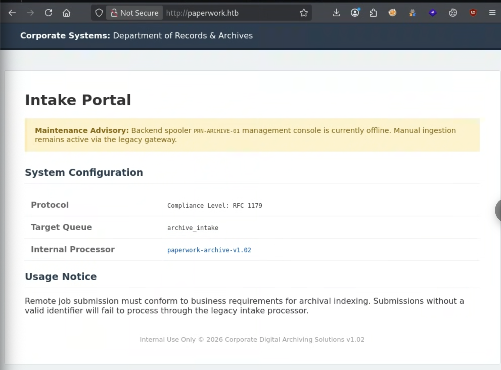

# [INCOMPLETO] PaperWork

**LINK: [https://app.hackthebox.com/machines/Paperwork?tab=play_machine](https://app.hackthebox.com/machines/Paperwork?tab=play_machine)**

**IP: 10.129.92.134**

Sono partito enumerando i servizi disponibili

```bash
kali@kali:~/Desktop$ sudo nmap -sS -sV -sC -p- 10.129.92.134 
[sudo] password for kali: 
Starting Nmap 7.99 ( https://nmap.org ) at 2026-09-06 05:36 -0400
Stats: 0:00:16 elapsed; 0 hosts completed (1 up), 1 undergoing SYN Stealth Scan
SYN Stealth Scan Timing: About 43.84% done; ETC: 05:37 (0:00:20 remaining)
Nmap scan report for 10.129.92.134
Host is up (0.052s latency).
Not shown: 65532 closed tcp ports (reset)
PORT     STATE SERVICE        VERSION
22/tcp   open  ssh            OpenSSH 10.0p2 Ubuntu 5ubuntu5.4 (Ubuntu Linux; protocol 2.0)
80/tcp   open  http           nginx 1.28.0 (Ubuntu)
|_http-server-header: nginx/1.28.0 (Ubuntu)
|_http-title: Did not follow redirect to http://paperwork.htb/
1515/tcp open  ifor-protocol?
| fingerprint-strings: 
|   TerminalServer, TerminalServerCookie: 
|_    Archive_Printer is ready and printing.
1 service unrecognized despite returning data. If you know the service/version, please submit the following fingerprint at https://nmap.org/cgi-bin/submit.cgi?new-service :
SF-Port1515-TCP:V=7.99%I=7%D=9/6%Time=6A9D345D%P=x86_64-pc-linux-gnu%r(Ter
SF:minalServerCookie,27,"Archive_Printer\x20is\x20ready\x20and\x20printing
SF:\.\n")%r(TerminalServer,27,"Archive_Printer\x20is\x20ready\x20and\x20pr
SF:inting\.\n");
Service Info: OS: Linux; CPE: cpe:/o:linux:linux_kernel

Service detection performed. Please report any incorrect results at https://nmap.org/submit/ .
Nmap done: 1 IP address (1 host up) scanned in 57.93 seconds
                                                                                      
kali@kali:~/Desktop$ 

```

| Servizio | Porta | Versione | Note |
| --- | --- | --- | --- |
| ssh | 22 | OpenSSH 10.0p2 |  |
| http | 80 | nginx 1.28.0 |  |
| - | 1515 | ? | Custom software |

Ho impostato come prima cosa l’ip su `/etc/hosts`

```bash
kali@kali:~/Desktop$ cat /etc/hosts
127.0.0.1       localhost
127.0.1.1       kali
::1             localhost ip6-localhost ip6-loopback
ff02::1         ip6-allnodes
ff02::2         ip6-allrouters

10.129.92.134 paperwork.htb
```

Aprendo il sito web `paperwork.htb` ci riporta questa pagina



Controllando il sorgente della pagina si vede che c’è un file scaricabile (.py) in `/download/archive` aprendolo è un programma python che apre un server `socket` utilizzato per gestire una coda di stampa

In particolare sembra interessante la riga `65` che contiene un comando subprocess `subprocess.Popen(f"echo 'Archive: {job_name}' >> /tmp/archive.log", shell=True)`
Probabilemnte è possibile iniettare codice malevolo.

Analizzando il codice vedo 2 cose interessanti

```python
def run(self):
  try:
      data = self.sock.recv(1024)
      if not data: return
      
      command = data[0]
      
      if command == 2:
          self.handle_print_job(data)
      elif command in (3, 4):
          self.sock.send(b"Archive_Printer is ready and printing.\n")
          
  except Exception as e:
      print(f"{self.id} Error: {e}")
  finally:
      self.sock.close()
```

Accetta due tipi di comandi, espressi attraverso byte:

`\x02` → Gestione del print job
`\x03, \x04`  → Gestione della coda di stampa

```python
kali@kali:~/Desktop$ echo -e "\x03" | nc 10.129.92.134 1515
Archive_Printer is ready and printing.
```

Stampa come immaginato lo stato.

```python
def handle_print_job(self, data):
    queue = data[1:].decode().strip()
    
    if queue not in VALID_QUEUE:
        print(f"{self.id} Rejected: Invalid queue '{queue}'")
        self.sock.send(b'\x01') 
        return
```

Per quanto riguarda la gestione della stampa, oltre al primo byte `\x02` vengono letti anche altri byte, proviamo a vedere con un comando casuale l’output

```python
kali@kali:~$ echo -e "\x02test" | nc 10.129.92.134 1515 | xxd
00000000: 01  
```

Perfetto il comando, ovviamente, non è valido ma almeno lha letto. Ora ho costruito uno script python, che mi stampa tutti le code disponibili, usando una wordlist di seclists, trovati facendo fuzzing.

```python
#!/usr/bin/env python3
import asyncio
import sys
from tqdm import tqdm

async def test_queue(sem, host, port, queue_name):
    """Testa una singola coda in modo asincrono"""
    async with sem:  # Limita il numero di connessioni simultanee
        try:
            # Connessione asincrona
            reader, writer = await asyncio.wait_for(
                asyncio.open_connection(host, port),
                timeout=2.0
            )
            
            # Invia il comando
            writer.write(b'\x02' + queue_name.encode())
            await writer.drain()
            
            try:
                # Prova a leggere la risposta con timeout breve
                response = await asyncio.wait_for(
                    reader.read(1024),
                    timeout=0.5
                )
                writer.close()
                await writer.wait_closed()
                return (queue_name, False)  # Ha risposto -> non valida
            except asyncio.TimeoutError:
                writer.close()
                await writer.wait_closed()
                return (queue_name, True)   # Nessuna risposta -> valida
            except:
                writer.close()
                await writer.wait_closed()
                return (queue_name, False)
        except:
            return (queue_name, False)

async def main_async(wordlist_path, host="10.129.92.134", port=1515, max_concurrent=500):
    """Main asincrono"""
    # Leggi wordlist
    try:
        with open(wordlist_path, 'r', encoding='utf-8', errors='ignore') as f:
            queues = [line.strip() for line in f if line.strip() and len(line.strip()) <= 50]
    except FileNotFoundError:
        print(f"[!] File non trovato: {wordlist_path}")
        return
    
    print(f"Target: {host}:{port}")
    print(f"Testing {len(queues)} code con {max_concurrent} connessioni simultanee...")
    print("="*60)
    
    valid_queues = []
    sem = asyncio.Semaphore(max_concurrent)  # Controlla il numero di connessioni
    
    # Crea tutti i task
    tasks = [test_queue(sem, host, port, queue) for queue in queues]
    
    # Esegui con barra di progresso
    with tqdm(total=len(tasks), desc="Testing", unit="code", ncols=80) as pbar:
        for coro in asyncio.as_completed(tasks):
            queue, is_valid = await coro
            if is_valid:
                valid_queues.append(queue)
                pbar.set_postfix({"Trovate": len(valid_queues)})
            pbar.update(1)
    
    # Risultati
    print("\n" + "="*60)
    if valid_queues:
        print(f"[✓] CODE VALIDE TROVATE ({len(valid_queues)}):")
        for q in valid_queues:
            print(f"    - {q}")
    else:
        print("[✗] Nessuna coda valida trovata")
    
    return valid_queues

def main():
    if len(sys.argv) < 2:
        print("Uso: python3 test_queues_async.py <wordlist.txt>")
        print("Esempio: python3 test_queues_async.py /usr/share/seclists/Discovery/Web-Content/common.txt")
        sys.exit(1)
    
    wordlist_path = sys.argv[1]
    
    # Esegui l'async main
    asyncio.run(main_async(wordlist_path))

if __name__ == "__main__":
    main()

```

```python
kali@kali:~/Desktop/CTF/Paperwork$ python3 test_queues.py /usr/share/seclists/Discovery/Web-Content/common.txt
Target: 10.129.92.134:1515
Testing 4748 code con 500 connessioni simultanee...
============================================================
Testing: 100%|██████████████| 4748/4748 [00:05<00:00, 934.51code/s, Trovate=193]

============================================================
[✓] CODE VALIDE TROVATE (193):
    - aliases
    - pages
    - 2002
    - alive
    - editpost
    - replicate
    - hide
    - m6_pay
    - patents
    - m7
    - pay
    - clipart
    - education
    - style_emoticons
    - web3
    - answer
    - effort
    - answers
    - paypal
    - reporting
    - 400
    - webaccess
    - closed
    - stylesheet
    - magazin
    - reports list
    - webadmin
    - closing
    - hitcount
    - paypalok
    - el
    - anuncios
    - webalizer
    - cluster
    - electronics
    - pbcs
    - subdomains
    - webapp
    - clusters
    - aol
    - holiday
    - reputation
    - pbcsi
    - cmd
    - elmar
    - webbbs
    - email
    - submitter
    - webcast
    - cnstats
    - mailing
    - pdf
    - hooks
    - pdf-invoice
    - emailhandler
    - mailinglist
    - pending
    - suggest
    - webdist
    - ADMIN
    - app_data
    - people
    - resin
    - webedit
    - cognos
    - hour
    - mainfile
    - resin-admin
    - suite
    - emergency
    - hourly
    - resize
    - webhits
    - suites
    - appeals
    - About
    - coldfusion
    - maintainers
    - emoticons
    - photodetails
    - website
    - arcade
    - matches
    - phpads
    - whatever
    - system
    - as
    - compare_product
    - ep
    - system-admin
    - whatnot
    - DMSDump
    - ascii
    - comparison_list
    - whatsnew
    - asdf
    - id_rsa
    - matt
    - phpbb2
    - roller
    - system_admin
    - Default
    - compat
    - eric
    - id_rsa.pub
    - maven
    - asia
    - Documents and Settings
    - err
    - compiled
    - idbc
    - mb
    - system_web
    - ask
    - complaint
    - erraddsave
    - idea
    - errata
    - mbox
    - rorindex
    - phpinfos.php
    - sysuser
    - whois
    - E
    - merchant
    - wp-rss
    - scr
    - poc
    - yearly
    - yml
    - yt
    - pressroom
    - _data
    - flyspray
    - it_IT
    - mycalendar
    - foo
    - czcmdcvt
    - tracks
    - _framework/blazor.webassembly.js
    - jigsaw
    - mcp
    - product_info
    - single
    - keep
    - academics
    - unlock
    - bz2
    - deleteme
    - c
    - proto
    - nr
    - unreg
    - siteadmin
    - acc
    - deletion
    - key
    - access
    - ca
    - function.require
    - sitecore
    - keygen
    - providers
    - unsafe
    - access-log
    - functionlude
    - ntopic
    - unsubscribe
    - access-log.1
    - cache
    - demo2
    - demos
    - oauth/device/code
    - skin1
    - upgrade.readme
    - user
    - old_site
    - userdir
    - .subversion
    - addpost
    - cars
    - dialog
    - python
    - userfiles
    - addreply
    - so
    - .svn
    - v3
    - discus
    - disdls
    - licenses
    - signaturepics
    - recommends
                                                                                      
kali@kali:~/Desktop/CTF/Paperwork$
```

Ha trovato un sacco di code! Peccato siano tutti falsi positivi 😂 . Codice scritto male, immaginavo, ritornando su `paperwork.htb`  e analizzando meglio il codice sorgente scopriamo:

```html
<tr>
    <td>Target Queue</td>
    <td><code>archive_intake</code></td>
</tr>
```

Ecco il nome della coda!

```html
kali@kali:~/Desktop/CTF/Paperwork$ echo -e "\x02archive_intake" | nc 10.129.92.134 1515 | xxd

^C

                                                                                      
kali@kali:~/Desktop/CTF/Paperwork$ 
```

E infatti non da `0x01` !

Analizzando la parte mancante della funzione:

```python
while True:
		# 1. Legge i dati successivi
    chunk = self.sock.recv(1024)
    if not chunk: break
    
    # Il primo byte è un altro byte di segnale
    # 0x01 funziona
    subcommand = chunk[0]
    self.sock.send(b'\x00') 
    parts = chunk[1:].decode(errors='ignore').split()
    if not parts: continue
    
    # dopo il "comando" si aspetta una dimensione del testo
    size = int(parts[0])
    content = b""
    
    # Legge size caratteri
    while len(content) < size:
        content += self.sock.recv(size - len(content) + 1)
    
    decoded_content = content.decode(errors='ignore')
    
    job_name = "Unknown"
    for line in decoded_content.split('\n'):
        line = line.strip()
        # Prendi il comando dopo la J
        if line.startswith('J'):
            job_name = line[1:]
            break
    
    print(f"{self.id} Executing archive for: {job_name}")
    subprocess.Popen(f"echo 'Archive: {job_name}' >> /tmp/archive.log", shell=True)
    
    self.sock.send(b'\x00') 
    self.sock.send(b'\x00')
    while self.sock.recv(4096):
        pass
    break

```

Guardando poi il codice del job:

```python
for line in decoded_content.split('\n'):
    line = line.strip()
    if line.startswith('J'):
        job_name = line[1:]
        break
                
```

Il job name deve iniziare con la `J`  che verrà poi non considerata.